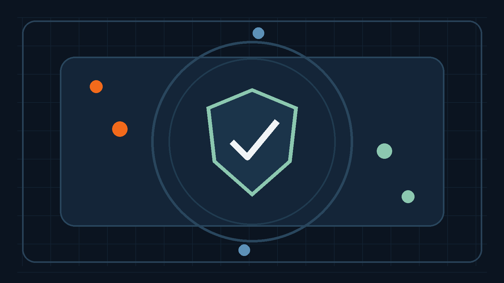

# Комплаенс как фундамент бизнеса: от «бумажной» работы к управлению рисками

В современной деловой среде комплаенс перестал быть прерогативой исключительно банковского сектора или крупных корпораций. Для компаний, вовлеченных во внешнеэкономическую деятельность (ВЭД), наличие выстроенной системы противодействия отмыванию денег (AML), проверки контрагентов (KYC/KYB) и санкционного мониторинга стало «входным билетом» на рынок.

Для руководителей бизнеса и специалистов по внутреннему контролю важно понимать: комплаенс — это не набор формальных документов, а динамическая система управления рисками.

## Комплаенс в ВЭД: почему старые подходы не работают

Еще несколько лет назад многие компании ограничивались формальной проверкой учредительных документов контрагента. Однако к 2026 году ландшафт рисков кардинально изменился. Сегодня регуляторы и банки-корреспонденты требуют прозрачности всей цепочки поставок, а не только прямого партнера по сделке.

Основные вызовы, с которыми сталкивается бизнес сегодня:
*   **Вторичные санкции:** Банки в третьих странах все чаще отказывают в обслуживании компаниям, чьи операции кажутся им подозрительными, чтобы избежать попадания под ограничения.
*   **Динамичность санкционных списков:** Списки OFAC, ЕС и ООН обновляются ежемесячно. Отсутствие автоматизированного мониторинга практически гарантирует, что рано или поздно компания проведет сделку с подсанкционным субъектом.
*   **Усложнение структуры собственности:** Выявление конечных бенефициарных владельцев (UBO) стало обязательным требованием. Использование «фирм-прокладок» для сокрытия реальных выгодоприобретателей легко выявляется современными системами комплаенс-контроля.

## Структура системы: KYC vs KYB

В профессиональной среде часто путают понятия KYC (Know Your Customer) и KYB (Know Your Business). Хотя обе процедуры являются частью AML-стратегии, их цели и инструменты различаются.

**KYC (Знай своего клиента)** фокусируется на физических лицах. Процесс включает проверку удостоверений личности, биометрию и анализ профиля риска.

**KYB (Знай свой бизнес)** — это более сложный и глубокий процесс, необходимый при работе с юридическими лицами. Он включает:
1.  **Проверку регистрации:** Подтверждение легитимности компании через официальные реестры.
2.  **Идентификацию бенефициаров:** Раскрытие структуры владения для выявления лиц, контролирующих бизнес.
3.  **Оценку деловой репутации:** Мониторинг негативных упоминаний в СМИ и базах данных.

Для руководителя важно осознать: KYB требует значительно больше ресурсов, чем KYC, из-за многослойности корпоративных структур и возможности использования компаний-оболочек.

## Практические шаги по внедрению комплаенс-системы

Эффективная система комплаенса базируется на риск-ориентированном подходе. Это означает, что глубина проверки должна соответствовать уровню риска контрагента или сделки.

### 1. Автоматизация как необходимость
Ручная проверка транзакций и контрагентов — это путь к ошибкам и неоправданным затратам времени. Использование специализированных IT-решений позволяет:
*   Проводить санкционный скрининг в режиме реального времени.
*   Автоматически выявлять аномалии в транзакциях (например, резкое изменение географии платежей).
*   Формировать отчетность для регуляторов без участия человека.

### 2. Непрерывный мониторинг (pKYC)
Классический подход «проверил один раз при онбординге» больше не работает. Современный стандарт — это *Perpetual KYC* (постоянный KYC). Риск-профиль контрагента может измениться в любой момент: компания может попасть под санкции, сменить владельца или стать фигурантом расследования. Система должна отслеживать эти изменения непрерывно.

### 3. Обучение персонала
Даже самая совершенная автоматизированная система бесполезна, если сотрудники не понимают, зачем нужны эти проверки. Внутренние регламенты должны быть понятными, а команда — обученной работе с инструментами проверки.

## Коммерческие последствия: цена ошибки

Отсутствие или слабость комплаенс-системы несет не только репутационные, но и прямые финансовые риски. В лучшем случае это блокировка платежей банками-корреспондентами и срыв поставок. В худшем — штрафы от регуляторов и внесение компании в «черные списки», что фактически означает закрытие доступа к международным рынкам.

## Вывод

Для современного бизнеса комплаенс — это инвестиция в устойчивость. Переход от реактивного подхода (решение проблем по мере их возникновения) к проактивному (постоянный мониторинг и оценка рисков) позволяет не только избежать санкций, но и повысить доверие со стороны партнеров и финансовых институтов. В 2026 году побеждает тот, кто умеет управлять рисками быстрее и точнее конкурентов.

## Источники

https://daat7x.com/ru/compliance.html
https://www.sostav.ru/blogs/289834/87929
https://sumsub.com/blog/aml-kyc-fintech
https://www.fenergo.com/blogs/kyc-vs-kyb\n