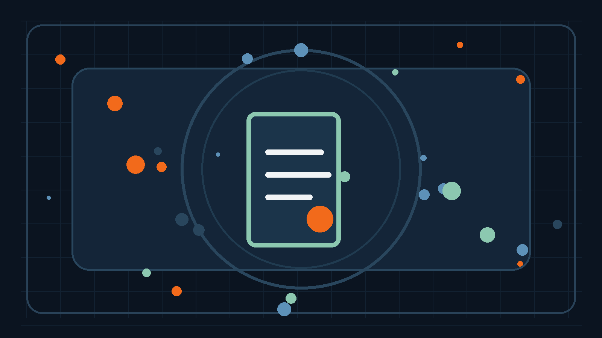

# США одобряют $2,8 млрд кредита для расширения электросети в Вайоминге

**Лид.** 18 ноября 2026 г. в США продолжается реализация масштабных программ по модернизации электросетей. На фоне растущего спроса на возобновляемую энергию и необходимости повышения надежности энергоснабжения, Министерство энергетики объявило о готовности предоставить условный кредит в размере до 2,8 млрд долларов компании Grid United для реализации проекта «Wyoming Intertie». Ожидается, что новое соединение увеличит пропускную способность сети на 1,8 ГВт, снизит стоимость электроэнергии для потребителей в 17 штатах и укрепит устойчивость западной части страны к экстремальным погодным явлениям.

## 1. Суть кредитного соглашения и ключевые параметры проекта

Условный кредит, объявленный Министерством энергетики США (DOE) в рамках программы Office of Energy Dominance Financing (EDF), предусматривает финансирование до 2,8 млрд долларов для строительства и ввода в эксплуатацию «Wyoming Intertie». Проект подразумевает возведение высоковольтных линий передачи, способных перемещать до 1,8 ГВт электроэнергии между центральными генераторами Вайоминга и потребителями в регионах, входящих в Western Electricity Coordinating Council (WECC) и Southwest Power Pool (SPP). По оценкам DOE, за счет снижения потерь при передаче и более эффективного распределения ресурсов проект может обеспечить экономию до 39 млрд долларов на счетах американских домохозяйств и предприятий в течение ближайших 20 лет.

Кредит будет предоставлен на условиях, требующих от Grid United выполнения строгих критериев по экологической ответственности, соблюдению сроков строительства и демонстрации готовности к интеграции возобновляемых источников энергии. Компания обязуется использовать современные технологии, включая сверхпроводящие кабели и автоматизированные системы управления нагрузкой, что должно повысить гибкость сети в условиях переменной генерации от ветра и солнца.

## 2. Региональное воздействие: от Вайоминга к 17 штатам Запада

Проект «Wyoming Intertie» имеет двойную цель: укрепить энергетическую независимость Вайоминга и обеспечить более стабильное снабжение электроэнергией в соседних штатах. Вайоминг, традиционно обладающий обширными запасами ископаемого топлива, в последние годы активно развивает ветровые и солнечные парки. Однако отсутствие достаточной пропускной способности линий передачи ограничивало возможность экспорта «зеленой» энергии в более густонаселённые регионы.

Увеличение трансферной мощности на 1,8 ГВт позволит перенаправлять избыток возобновляемой генерации в Калифорнию, Неваду, Аризону и другие штаты, где наблюдается рост спроса на чистую энергию. По предварительным расчётам, в течение первого года эксплуатации проект может сократить потребление ископаемого топлива в регионе на 5 %, а выбросы CO₂ — на 3 млн тонн. Для потребителей это означает снижение средних тарифов на электроэнергию примерно на 4–5 % в сравнении с текущими показателями.

Кроме того, усиление сетевой инфраструктуры повысит устойчивость к экстремальным погодным событиям, таким как сильные ветры и снежные бури, которые в последние годы часто приводили к отключениям в западных штатах. Интеграция автоматизированных систем мониторинга и быстрой реакцией на сбои позволит сократить продолжительность отключений на 30 % по сравнению с текущими данными WECC.

## 3. Политический и регуляторный контекст: исполнительный указ и программа SPARK

Кредитный пакет является частью более широкой стратегии федерального правительства, направленной на укрепление надежности и безопасности национальной электросети. В 2025 году президент Дональд Трамп издал Исполнительный указ «Strengthening the Reliability and Security of the U.S. Electric Grid», который предписал Департаменту энергетики ускорить реализацию проектов по модернизации инфраструктуры, в том числе через механизмы государственного финансирования.

В рамках этого указа в 2026 году было запущено несколько инициатив, среди которых программа Speed to Power through Accelerated Reconductoring and other Key Advanced Transmission Technology Upgrades (SPARK). Программа SPARK ориентирована на замену устаревших проводников, внедрение новых материалов и цифровизацию управления сетью. Кредит для Grid United считается первым крупным проектом, реализуемым в рамках SPARK, и служит демонстрационным образцом того, как частный сектор может привлекать государственное финансирование для ускорения перехода к более гибкой и чистой энергетической системе.

## 4. Международные сравнения и перспективы дальнейшего развития

Инвестиции в масштабные сетевые проекты не ограничиваются США. В Европе в 2026 году Европейская комиссия объявила о выделении 1,5 млрд евро на модернизацию трансграничных линий в рамках проекта «North Sea Link», а в Китае правительство планирует инвестировать более 10 млрд долларов в развитие сверхвысоковольтных линий для соединения регионов с высоким потенциалом ветровой энергии. Сравнительный анализ показывает, что американский кредит в 2,8 млрд долларов находится в среднем диапазоне международных инвестиций, однако его особенность — привязка к конкретным показателям экономии для конечных потребителей — делает его уникальным инструментом стимулирования рыночных выгод.

Для России и других стран СНГ такие проекты могут стать ориентиром при планировании собственных программ модернизации сетей. В частности, в России в 2026 году планируется запуск проекта «Сибирская электросеть», предусматривающего увеличение пропускной способности на 1,2 ГВт. При этом российские регуляторы рассматривают возможность создания аналогичных кредитных механизмов, позволяющих привлекать частный капитал при условии соблюдения экологических и технологических стандартов.

## 5. Практические выводы для бизнеса и потребителей

* **Для инвесторов**: условный кредит от DOE демонстрирует готовность федерального правительства поддерживать крупные инфраструктурные проекты, что снижает финансовый риск и повышает привлекательность инвестиций в энергетический сектор.
* **Для энергетических компаний**: участие в проектах, связанных с программой SPARK, открывает доступ к передовым технологиям и позволяет быстрее интегрировать возобновляемые источники энергии.
* **Для потребителей**: ожидаемое снижение тарифов и повышение надежности поставок делают такие проекты выгодными с точки зрения конечных расходов и качества обслуживания.
* **Для регуляторов**: пример США показывает, как сочетание исполнительных указов, целевых программ и гибких финансовых инструментов может ускорить модернизацию сети без значительного увеличения государственных расходов.

В целом, кредит в размере $2,8 млрд, предоставленный DOE компании Grid United, представляет собой важный шаг в реализации национальной стратегии по обеспечению энергетической безопасности, снижению стоимости электроэнергии и поддержке перехода к более чистой энергетике.

## Источники
- [Energy Department Announces $2.8 Billion Loan to Strengthen Grid Reliability and Help Lower Costs in Wyoming | Department of Energy](https://www.energy.gov/articles/energy-department-announces-28-billion-loan-strengthen-grid-reliability-and-help-lower)
