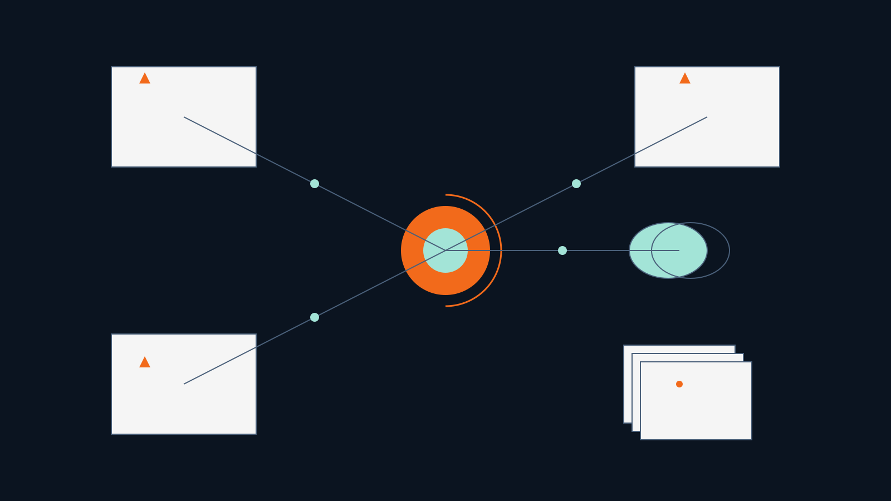

# Трансформация систем внутреннего контроля и комплаенса: от разовой проверки к непрерывному управлению рисками

По состоянию на ноябрь 2026 года глобальная и российская практика комплаенса переживают структурный сдвиг. Эпоха, когда управление рисками легализации преступных доходов и соблюдение регуляторных норм сводились к формальному сбору документов при открытии счёта и эпизодическим календарным пересмотрам досье, окончательно уходит в прошлое. Усложнение корпоративных структур, жесткие требования международных и национальных регуляторов, а также рост угроз с использованием искусственного интеллекта вынуждают компании перестраивать внутренний контроль в режим непрерывного мониторинга.

Для руководителей комплаенс-департаментов, директоров по внутреннему аудиту и высшего руководства бизнеса это означает необходимость пересмотра всей архитектуры проверки контрагентов и клиентов. Главными вызовами становятся объединение процедур KYC (Know Your Customer) и KYB (Know Your Business) в единую экосистему AML (Anti-Money Laundering), внедрение концепции перманентного комплаенса (pKYC), ремедиация накопленных клиентских портфелей и подготовка к новым стандартам внутреннего контроля, вступающим в силу в 2026–2027 годах.

## Единый контур KYC, KYB и AML: почему регуляторы больше не оценивают элементы отдельно

В традиционной практике финансового контроля идентификация физических лиц (KYC) и проверка юридических лиц (KYB) нередко существовали как обособленные операционные процессы. Однако регуляторная практика FinCEN, британского FCA и европейских надзорных органов наглядно демонстрирует: проверяющие структуры воспринимают комплаенс как единую взаимосвязанную контрольную среду. Любая брешь в установлении конечных бенефициарных владельцев (UBO) при проведении KYB классифицируется не как локальная техническая ошибка, а как системный сбой всей программы AML.

Фундаментальная разница между KYC и KYB заключается в объеме и многослойности проверяемых данных. Проверка бизнеса не заменяет идентификацию физических лиц, а дополняет её. Полноценный KYB-процесс требует одновременной валидации правового статуса компании, структуры её владения и управления, выявления лиц с существенным контролем и последующего проведения полноценного KYC-анализа в отношении каждого бенефициара и директора.

Современная AML-модель строится на пяти ключевых столпах:
1. Разработка и внедрение внутренних процедур контроля.
2. Проведение независимого аудита и тестирования системы.
3. Назначение квалифицированного офицера по комплаенсу (MLRO).
4. Регулярное и систематическое обучение персонала.
5. Осуществление непрерывной надлежащей проверки клиентов (CDD) на основе рискового подхода.

Главная ошибка комплаенс-команд заключается в представлении о KYC и KYB как о разовом входном барьере. Без постоянного сопоставления фактического поведения клиента с профилем, заявленным при онбординге, система теряет смысл. Автоматизация процессов с помощью современных RegTech-платформ позволяет оперативно обрабатывать документы, но одновременно несёт в себе риски: автоматика мгновенно тиражирует некорректные или искажённые входящие данные. Если базовый профиль клиента или бенефициара сформирован с ошибками, последующий транзакционный мониторинг начинает генерировать либо ложноотрицательные результаты, либо огромный поток ложных срабатываний. Поэтому регулярная выборочная проверка первичных досье остается обязательным элементом внутреннего контроля.

## Динамический комплаенс и непрерывный мониторинг (pKYC): отмена календарных проверок

На смену жестким календарным графикам пересмотра клиентских дел (например, раз в год или раз в три года) приходит концепция непрерывного комплаенса — Perpetual KYC (pKYC). Её суть заключается в том, что повторные проверки запускаются не наступлением определенной даты, а возникновением реальных рисковых триггеров в режиме реального времени.

В качестве таких триггеров выступают:
* Изменения в структуре собственности или составе директоров компании;
* Появление негативных публикаций в СМИ (adverse media);
* Включение связанных лиц или юрисдикций в санкционные списки;
* Резкое изменение географии операций или отклонение транзакционного поведения от заявленного профиля.

Особое значение в этой модели приобретает скрининг негативного фона в СМИ и проверка политически значимых лиц (PEP). Проверка по базам данных должна охватывать не только самих клиентов, но и их бенефициаров, руководителей, а в случае KYB — ключевых поставщиков и контрагентов. Современные инструменты мониторинга проверяют списки санкций и PEP-реестры, обновляемые каждые 15 минут по тысячам источников в сотнях юрисдикций. Это позволяет оперативно учитывать динамические изменения, включая обновление оценок страновых рисков по решениям ФАТФ.

Вместе с тем внедрение автоматизированного скрининга создает проблему качества данных и уязвимости коммерческих баз. Использование крупных международных платформ, содержащих миллионы профилей (таких как LSEG World-Check), требует от комплаенс-офицеров высокой степени проверки и прозрачности решений. Судебные разбирательства и прецеденты 2026 года в Высоком суде Лондона и других инстанциях, связанные с оспариванием корректности внесения лиц в категории PEP или лиц с негативным репутационным профилем, показывают: ошибочное присвоение высокого риска или необоснованное прекращение обслуживания (de-risking) влечет серьезные юридические и финансовые последствия для самих организаций. Каждое комплаенс-решение должно иметь четкий аудиторский след и подтвержденные первоисточники.

## Ремедиация клиентской базы и усиленная надлежащая проверка (EDD)

Регуляторные изменения, вступающие в силу в ближайшие годы — включая применение Европейского регламента по борьбе с отмыванием денег (AMLR) с июля 2027 года, — ставят перед финансовыми и корпоративными институтами задачу ремедиации (актуализации) уже существующей клиентской базы. Аналитические исследования 2026 года в сфере комплаенса подчеркивают: надзорные органы не требуют одномоментной перепроверки всех портфелей. Внедряется дифференцированный подход к срокам:
* 1 год отводится на полную актуализацию досье клиентов с высоким уровнем риска;
* До 5 лет предоставляется на поэтапную проверку остальных категорий клиентов.

Основной принцип эффективной ремедиации — отсутствие необходимости полностью перерабатывать каждое дело. Спецслужбам комплаенса достаточно провести точечный аудит имеющихся сведений, определить отсутствующие или устаревшие данные (например, подтверждение источников происхождения средств или свежие данные о бенефициарах) и устранить именно эти пробелы.

При выявлении повышенного риска активируется механизм усиленной надлежащей проверки (Enhanced Due Diligence — EDD). Триггерами для EDD становятся наличие статуса PEP, связи с юрисдикциями из серой или черной зон, а также сложнообъяснимые корпоративные цепочки. Стандартный протокол EDD включает сбор дополнительных сведений о происхождении капитала и источников благосостояния, независимую верификацию данных по официальным реестрам и обязательное утверждение высшим руководством компании решения о начале или продолжении сотрудничества.

Согласно исследованию UK Compliance Reality Check 2026, охватившему 1000 руководителей регулируемых секторов, 95% компаний сталкиваются с существенными сложностями при обеспечении комплаенса, а 72% ожидают дальнейшего роста регуляторной нагрузки. При этом 77% респондентов обеспокоены репутационными рисками от возможной связи с финансовыми преступлениями, 87% готовы немедленно разорвать отношения с деловым партнером при одиночном комплаенс-нарушении, а 24% назвали мошенничество с использованием ИИ своей главной новой угрозой.

## Практическая организация внутреннего контроля и подготовка к регуляторным аудитам

В российской практике ключевым ориентиром для специалистов по контролю выступают обновленные нормативные требования. В частности, принятый Федеральный стандарт внутреннего контроля обязывает организации уже в 2026 году начать полноценную подготовку к внедрению новых правил, которые становятся строго обязательными с 1 января 2027 года.

Стандарт предписывает выстраивать внутренний контроль по двум неразрывным направлениям:
1. Оформление и санкционирование фактов хозяйственной жизни;
2. Ведение бухгалтерского и финансового учета.

Контроль должен быть встроен во все этапы операций — от составления первичного документа до формирования итоговой отчетности. Организациям необходимо грамотно комбинировать способы контроля (сплошной для критических транзакций и выборочный для рутинных процессов), а также применять три вида контроля: предварительный (до совершения операции), текущий (в процессе исполнения) и последующий (на этапе анализа результатов).

При подготовке к внешним и внутренним AML-аудитам комплаенс-служба должна быть готова предоставить документальные свидетельства по восьми критическим зонам:
* Актуальная общекорпоративная оценка рисков с фиксацией даты последнего пересмотра;
* Утвержденные политики и регламенты KYC/KYB, CDD/EDD и обработки алертов;
* Документы о наделении полномочиями ответственного офицера (MLRO) и разграничении ответственности на уровне правления;
* Выборка клиентских досье за проверяемый период, включая дела, прошедшие EDD;
* Журналы транзакционного мониторинга и скрининга санкций с историей закрытия сигналов;
* Реестр направленных (и рассмотренных, но отклоненных) сообщений о подозрительных операциях с мотивированным обоснованием каждого решения;
* Программа обучения сотрудников и журналы прохождения тренингов за последний цикл;
* Политика хранения данных и доказательства её практического соблюдения.

Отдельное внимание аудиторы и регуляторы уделяют объяснимости алгоритмов. Если организация использует автоматизированные системы оценки рисков или транзакционные правила на базе ИИ, в системе должны фиксироваться версии используемых моделей, входные параметры и любые случаи, когда аналитик-человек вручную переопределил (override) решение системы.

## Заключение: ключевые выводы для руководителей

Современный комплаенс перестал быть изолированной функциями «бумажной» проверки и превратился в технологичный операционный контур управления рисками. Для обеспечения устойчивости бизнеса руководителям комплаенс-подразделений и менеджменту рекомендуется сосредоточиться на следующих практических шагах:

1. **Объединить KYC и KYB в единую систему.** Не рассматривать проверку юридических лиц отдельно от анализа их бенефициаров и транзакционной активности. Любой пропуск в UBO-анализе признается регуляторами системным сбоем AML.
2. **Перейти от календарных проверок к триггерному мониторингу (pKYC).** Настроить автоматическое обновление данных при наступлении рисковых событий: изменениях в структуре владения, появлении негатива в СМИ, санкционных апдейтах или изменении гео-профиля.
3. **Провести рискоориентированную ремедиацию.** Сфокусировать ресурсы на актуализации портфеля клиентов высокого риска в первоочередном порядке (с горизонтом до 1 года), устраняя конкретные пробелы в досье вместо дублирования работы.
4. **Обеспечить полную аудируемость решений.** Внедрить жесткую фиксацию мотивировок по всем алертам, отчетам о подозрительных операциях и ручным отменам системных рекомендаций, чтобы подтвердить качество контроля перед регулятором.
5. **Своевременно адаптировать внутренние стандарты.** Сформировать методологическую базу и провести подготовку процессов к нормативным требованиям 2026–2027 годов, установив трехстадийный контроль (предварительный, текущий, последующий) над всеми фактами хозяйственной жизни.

## Источники
- [KYC vs KYB vs AML: Understanding Compliance Requirements](https://pillarsfincrimeadvisory.com/feeds/blog/kyc-vs-kyb-vs-aml-compliance)
- [Enhanced Due Diligence Triggers, Explained with Real Scenarios](https://www.identomat.com/blog/enhanced-due-diligence-triggers-explained-with-real-scenarios)
- [AML and KYC compliance in Identity Verification KYC KYB Platforms | Parse](https://parse.gl/questions/which-aml-kyc-tools-should-i-consider--087c02b2-e9a6-483c-9921-f2e0792ebb9d)
- [Transaction Monitoring Scenarios Examples for AML](https://www.fluxforce.ai/blog/transaction-monitoring-scenarios-examples)
- [AML & KYC Compliance Services | KYB Due Diligence | ChesaGroup](https://chesagroup.com/en/corporate-services/aml-and-kyc-compliance-services)
- [What AMLR Means For Your Existing Customer Book | Trulioo](https://www.trulioo.com/blog/compliance/amlr-existing-customers-remediation-timeline)
- [Стандарт внутренний контроль: новые требования с 2026 года](https://www.budgetnik.ru/art/105160-federalnyy-standart-vnutrennego-kontrolya-novye-trebovaniya-s-2026-goda)
- [AML Audit: What Is Checked and How to Prepare the Report | COREDO](https://coredo.eu/aml-audit-what-is-checked-how-to-prepare-report)
- [    | Innovate Finance](https://www.linkedin.com/posts/innovate-finance_pkyc-kyc-aml-activity-7527009652191125506-yj5n)
- [Nigeria Banking 2027: From AML Roadmap to Readiness](https://sumsub.com/blog/webinars/nigeria-aml-roadmap-2027)
- [Adverse Media Screening: A Quick Guide](https://www.sesamm.com/blog/adverse-media-screening-what-it-is-and-how-to-do-it-at-scale)
- [Bureau on Instagram: "How much of your KYB team's time goes into ...](https://www.instagram.com/p/DfrcIsdGUSE)
- [100+ KYC Analyst Interview Questions & Answers (Updated 2026)](https://www.ambitionbox.com/profiles/kyc-analyst/interview-questions)
- [Effects of money laundering on the economy and banks](https://complead.ai/blog/effects-of-money-laundering)
- [Trusts can make AML onboarding feel like a whole different ball ...](https://www.facebook.com/easyaml/posts/trusts-can-make-aml-onboarding-feel-like-a-whole-different-ball-game-youve-got-a/122219627036887236)
- [The compliance industry is at an inflection point. Here is where I think it goes next.](https://www.smartsearch.com/resources/blog/the-compliance-industry-is-at-an-inflection-point.-here-is-where-i-think-it-goes-next)
- [Методические материалы СРО ААС по ПОД/ФТ/ФРОМУ. Пресс-центр СРО ААС](https://sroaas.ru/pc/actions/metodicheskie_materialy_sro_aas_po_podftfromu)
- [AML Vendor Risk Report | Lyon & Fiurex](https://lyonnfiurex.com/aml-vendor-risk)
- [Flexible Remote Sanctions Jobs](https://uk.indeed.com/q-remote-sanctions-jobs.html)
