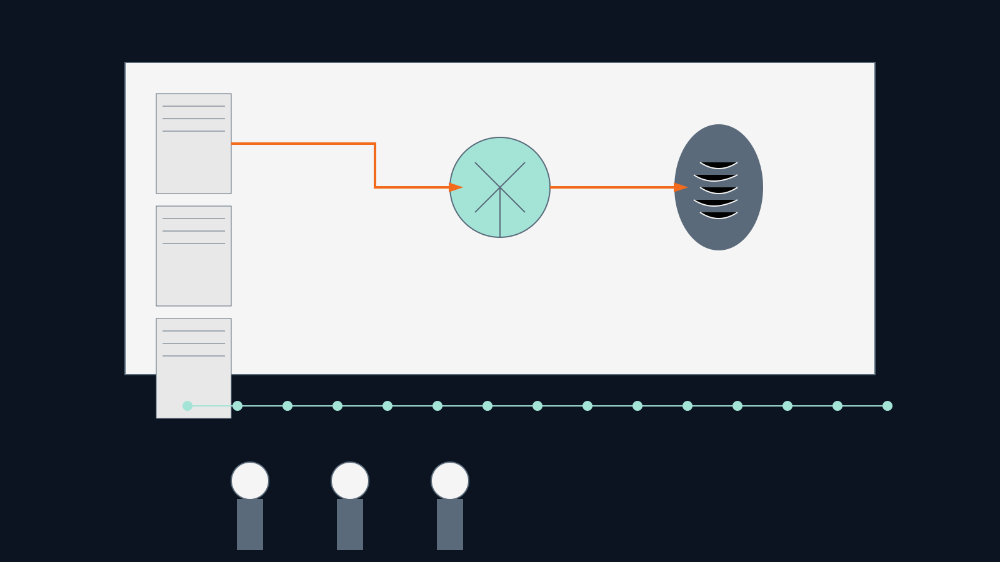

# Комплаенс-система в 2026 году: переход к непрерывному управлению рисками

В 2026 году комплаенс перестал быть функцией «бэк-офиса», отвечающей лишь за формальное наличие документов. Сегодня это операционный фундамент бизнеса, напрямую влияющий на его выживаемость и репутацию. С учетом роста сложности транзакционных схем, появления изощренных методов мошенничества с использованием ИИ и ужесточения регуляторных требований по всему миру, руководители комплаенс-департаментов сталкиваются с необходимостью радикальной трансформации своих систем. Переход от периодических проверок к модели непрерывного мониторинга (perpetual KYC) становится не просто трендом, а обязательным условием для работы на регулируемых рынках.

## От «бумажной» проверки к управлению рисками в реальном времени

Современная парадигма комплаенса строится на понимании того, что статические данные быстро устаревают. Если раньше бизнес-процессы опирались на ежегодный цикл обновления данных о клиенте, то сегодня такой подход признан неэффективным. Регуляторы и аудиторы всё чаще требуют доказательств того, что компания понимает риски своих контрагентов в моменте.

Практическая реализация этого подхода требует интеграции KYC (Know Your Customer) и KYB (Know Your Business) в единый контур с мониторингом транзакций. Важно не просто собрать пакет документов при онбординге, а создать «базовую линию» поведения клиента. Когда система знает, что является «нормой» для конкретного контрагента, она способна мгновенно реагировать на отклонения — будь то резкое изменение географии платежей или появление негативных упоминаний в СМИ.

Для руководителей это означает необходимость инвестиций в системы, которые обеспечивают автоматизированный сбор данных об UBO (конечных бенефициарных владельцах), проверку по санкционным спискам и мониторинг неблагоприятной деловой репутации (adverse media). При этом критически важно разделять сигналы: автоматизация, которая просто «тиражирует» ошибки или генерирует избыточное количество ложноположительных срабатываний, только увеличивает нагрузку на аналитиков, не повышая уровень безопасности.

## Технологический стек: автоматизация и роль ИИ

Инструментарий комплаенс-офицера в 2026 году значительно усложнился. Рынок предлагает решения, использующие агентный ИИ для обработки сложных документов, таких как трастовые декларации, или для выявления дипфейков при биометрической верификации. Однако технология — это лишь инструмент. Главный вызов заключается в настройке «fuzzy matching» (нечеткого поиска) и пороговых значений для фильтрации рисков.

Практический опыт показывает, что наиболее успешные компании внедряют системы, которые позволяют:
1. Автоматически проверять контрагентов по глобальным базам санкций и PEP (политически значимых лиц).
2. Проводить верификацию личности с использованием биометрии и проверки «живости» (liveness detection).
3. Настраивать сценарии мониторинга транзакций, которые учитывают специфику отрасли, а не полагаются на универсальные шаблоны.

Важным аспектом становится ведение «аудиторского следа» (audit trail). Регуляторы требуют не только факта проверки, но и обоснования принятых решений. Если аналитик принял решение проигнорировать алерт, система должна зафиксировать логику этого действия. Внедрение ПО, которое логирует версии моделей и действия сотрудников, позволяет проходить проверки регуляторов значительно быстрее, так как доказательная база формируется автоматически в процессе работы.

## Человеческий фактор и организационная структура

Даже самая совершенная автоматизированная система не исключает необходимости в квалифицированных кадрах. Основная проблема многих организаций в 2026 году — фрагментарность процессов. Когда отделы онбординга, риск-менеджмента и внутреннего аудита работают в «силосах», информация о подозрительных операциях теряется, а коррекционные меры не имеют четкого владельца.

Руководителям рекомендуется пересмотреть структуру взаимодействия команд. Эффективная модель предполагает создание кросс-функциональных групп, где ответственность за клиента закреплена на всем протяжении его жизненного цикла. Это включает в себя:
* Регулярное обучение персонала методам выявления финансового мошенничества.
* Четкое распределение полномочий при эскалации алертов.
* Использование инструментов для управления кейсами (case management), которые объединяют данные из разных источников в единый профиль клиента.

Особое внимание следует уделить «культуре комплаенса». Если сотрудники воспринимают проверки как досадную помеху, вероятность пропуска критического сигнала возрастает. Обучение должно быть сфокусировано не на заучивании инструкций, а на понимании того, как конкретные действия по проверке контрагента защищают компанию от штрафов, потери лицензии и уголовной ответственности.

## Подготовка к регуляторным изменениям: взгляд в будущее

Регуляторная среда становится все более жесткой. Введение новых стандартов (например, предстоящие в 2027 году изменения в AML-регулировании в ряде юрисдикций) требует от бизнеса готовности к масштабным ремедиациям (актуализации данных по существующей клиентской базе).

Для бизнеса это не должно стать «пожарной командой» в последний момент. Стратегический подход подразумевает использование периодов адаптации для модернизации инфраструктуры. Компании, которые рассматривают новые требования как возможность обновить устаревшие системы и внедрить более эффективные процессы, получают конкурентное преимущество.

Вывод для руководителя очевиден: комплаенс сегодня — это не затраты, а инвестиция в устойчивость бизнеса. Использование современных платформ для автоматизации KYC/KYB, отказ от ручных проверок в пользу риск-ориентированного подхода и создание прозрачных процедур принятия решений позволяют не только соответствовать букве закона, но и снижать операционные издержки, высвобождая время экспертов для анализа действительно сложных и опасных кейсов.

## Источники
- [AML and KYC compliance in Identity Verification KYC KYB Platforms | Parse](https://parse.gl/questions/which-aml-kyc-tools-should-i-consider--087c02b2-e9a6-483c-9921-f2e0792ebb9d)
- [Transaction Monitoring Scenarios Examples for AML](https://www.fluxforce.ai/blog/transaction-monitoring-scenarios-examples)
- [AML & KYC Compliance Services | KYB Due Diligence | ChesaGroup](https://chesagroup.com/en/corporate-services/aml-and-kyc-compliance-services)
- [AML & KYC Software for US Fintechs | WorldAML](https://worldaml.com/markets/usa)
- [What AMLR Means For Your Existing Customer Book | Trulioo](https://www.trulioo.com/blog/compliance/amlr-existing-customers-remediation-timeline)
- [Стандарт внутренний контроль: новые требования с 2026 года](https://www.budgetnik.ru/art/105160-federalnyy-standart-vnutrennego-kontrolya-novye-trebovaniya-s-2026-goda)
- [7 AML Program Controls for Compliance Teams | ComplyCube](https://www.complycube.com/en/7-aml-program-controls)
- [AML Audit: What Is Checked and How to Prepare the Report | COREDO](https://coredo.eu/aml-audit-what-is-checked-how-to-prepare-report)
- [transaction-monitoring · GitHub Topics · GitHub](https://github.com/topics/transaction-monitoring)
- [7 Trulioo alternatives to consider for KYC and KYB verification](https://www.gbg.com/en-us/blog/trulioo-alternatives)
- [AML Software for Transaction Monitoring, KYC & Risk Scoring](https://smartintegrityplatform.com/aml-software-with-ai)
- [Nigeria Banking 2027: From AML Roadmap to Readiness](https://sumsub.com/blog/webinars/nigeria-aml-roadmap-2027)
- [    | Innovate Finance](https://www.linkedin.com/posts/innovate-finance_pkyc-kyc-aml-activity-7527009652191125506-yj5n)
- [Bureau on Instagram: "How much of your KYB team's time goes into investigating businesses, and how much goes into processi…"](https://www.instagram.com/p/DfrcIsdGUSE)
- [DFS Compliance Manager - KCB Group Careers - Cloud Sign In](https://eoin.fa.em3.oraclecloud.com/hcmUI/CandidateExperience/en/sites/CX_3001/job/6803?=undefined)
- [Easy AML on Facebook: "Trusts can make AML onboarding feel like a whole different ball game 😵‍💫 You've got a trust deed to …"](https://www.facebook.com/easyaml/posts/trusts-can-make-aml-onboarding-feel-like-a-whole-different-ball-game-youve-got-a/122219627036887236)
- [The compliance industry is at an inflection point. Here is where I think it goes next.](https://www.smartsearch.com/resources/blog/the-compliance-industry-is-at-an-inflection-point.-here-is-where-i-think-it-goes-next)
- [Методические материалы СРО ААС по ПОД/ФТ/ФРОМУ. Пресс-центр СРО ААС](https://sroaas.ru/pc/actions/metodicheskie_materialy_sro_aas_po_podftfromu)
