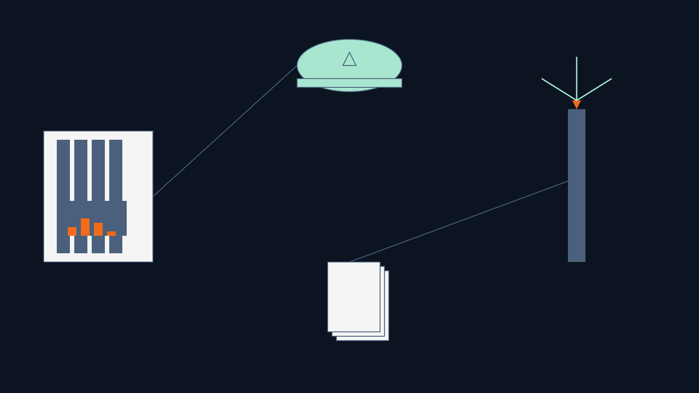

# Финансовый регулятор, местные коммунальные контракты, отчёт о дезинформации и деятельность Конгресса США: события 18 ноября 2026 г.

**18 ноября 2026 г. в США поступило несколько официальных публикаций, отражающих активность как федеральных регуляторов, так и местных органов власти.** В Федеральном реестре опубликовано уведомление о подаче NYSE Arca, Inc. предложения о внесении изменений в правила биржи, позволяющих листинг бинарных опционов, привязанных к ключевым показателям эффективности (KPI). В Калифорнии Совет директоров Cosumnes Community Services District (CSD) одобрил профессиональный сервисный договор с компанией EX2 Technologies, LLC, направленный на управление телекоммуникационным портфелем. Совместно с этим, Совет по надзору за конфиденциальностью и гражданскими свободами (PCLOB) выпустил отчёт, посвящённый дезинформации и усилению правоприменения в сфере иностранного влияния. На официальном портале Congress.gov зафиксировано расписание заседаний Палаты представителей на тот же день. Ниже — подробный разбор каждой публикации, их контекст и возможные последствия.

## NYSE Arca предлагает листинг бинарных опционов, привязанных к ключевым показателям эффективности

В документе Федерального реестра от 18 ноября 2026 г. NYSE Arca, Inc. уведомила о подаче заявки на немедленную эффективность предлагаемого изменения правил. Основная цель — разрешить листинг бинарных опционов, базирующихся на KPI, то есть на измеримых показателях работы компаний, таких как выручка, EBITDA или другие финансовые и операционные метрики. По заявке биржа планирует создать отдельный класс продуктов, которые будут отличаться от традиционных бинарных опционов, привязанных к ценовым уровням активов.

Регуляторный процесс подразумевает публичное обсуждение, в ходе которого заинтересованные стороны могут представить комментарии. После их рассмотрения SEC примет окончательное решение. Предлагаемая новация может расширить инструменты хеджирования и спекуляции для инвесторов, позволяя более точно фиксировать риск, связанный с достижением конкретных бизнес‑целей. С другой стороны, критики указывают на потенциальные риски для неквалифицированных участников рынка, поскольку бинарные опционы часто ассоциируются с высоким уровнем волатильности и быстрым оборотом капитала.

Если правило будет принято, NYSE Arca станет первой крупной американской биржей, предлагающей такой продукт, что может стимулировать конкуренцию среди других площадок и вызвать необходимость пересмотра нормативных требований к раскрытию информации о KPI‑ориентированных инструментах.

## Cosumnes Community Services District заключил договор с EX2 Technologies по управлению телекоммуникационным портфелем

В документе Совета директоров Cosumnes Community Services District, размещённом на официальном сайте округа и датированном 18 ноября 2026 г., зафиксировано одобрение профессионального сервисного соглашения с компанией EX2 Technologies, LLC. Договор охватывает услуги по управлению телекоммуникационным портфелем, включая планирование, мониторинг и оптимизацию сетевых ресурсов, а также обеспечение соответствия требованиям государственных и региональных нормативов.

Отчёт подчёркивает, что процесс заключения соглашения прошёл в полном соответствии с внутренними политиками финансового контроля, предусмотренными разделом 2130.29 Государственного кодекса и разделами 53630‑53686. В частности, в документе указано, что бюджетные обязательства за шесть последующих месяцев проверены, и подтверждена способность округа покрыть предстоящие расходы без нарушения финансовой дисциплины.

Для жителей округа Cosumnes такой шаг может означать более надёжную и современную инфраструктуру связи, что особенно актуально в условиях растущего спроса на удалённую работу и цифровые услуги. Для EX2 Technologies соглашение открывает доступ к новому клиентскому сегменту в сфере коммунальных услуг, где требования к надёжности и соответствию регуляторным нормам традиционно высоки.

## PCLOB опубликовал отчёт о дезинформации и усилении правоприменения в сфере иностранного влияния

Совет по надзору за конфиденциальностью и гражданскими свободами (Privacy and Civil Liberties Oversight Board) 18 ноября 2026 г. выпустил подробный отчёт в формате PDF, посвящённый проблемам дезинформации и мерам, принимаемым правительством США для противодействия иностранному влиянию. В документе подчёркивается, что Министерство юстиции недавно объявило о готовности активно применять два федеральных закона: Закон о регистрации иностранных агентов (FARA) и раздел 18 U.S.C. § 951, регулирующий деятельность незарегистрированных иностранных агентов.

Отчёт приводит примеры недавних дел, в том числе обвинения в отношении сотрудников российского международного телеканала RT, которые, по данным Министерства юстиции, финансировали и руководили американской компанией, публиковавшей тысячи видеоматериалов в интересах России. Такие случаи иллюстрируют, как дезинформационные кампании могут использовать легальные бизнес‑структуры для скрытого влияния на общественное мнение.

PCLOB отмечает, что усиление правоприменения должно сочетаться с прозрачностью и защитой конституционных прав, в частности свободы слова. В заключении совет рекомендует усилить межведомственное взаимодействие, улучшить механизмы мониторинга онлайн‑контента и обеспечить более широкое информирование общественности о юридических обязательствах, связанных с иностранным влиянием.

## На палате представителей США зафиксировано заседание 18 ноября 2026 г.

Официальный портал Congress.gov опубликовал страницу «On the House Floor on November 18, 2026», где указано расписание и тематика заседаний 119‑го Конгресса (2025‑2026). Хотя в открытом фрагменте не перечислены конкретные законопроекты, сама публикация свидетельствует о том, что в этот день Палата представителей проводила обычные процедуры: рассмотрение поправок, голосования по нескольким законопроектам и выступления членов комиссии.

Наличие такой публичной информации подчёркивает принцип открытости законодательного процесса в США, позволяя гражданам и аналитикам отслеживать ход обсуждения актуальных вопросов. По опыту предыдущих дней, в расписании часто присутствуют темы, связанные с финансовым регулированием, кибербезопасностью и национальной безопасностью, что согласуется с другими новостями, опубликованными в тот же день.

## Сводный взгляд: усиление контроля над финансовыми и информационными рынками

Сочетание четырёх официальных публикаций, появившихся 18 ноября 2026 г., позволяет увидеть общую тенденцию: федеральные и местные органы США усиливают надзор как в сфере финансов, так и в области информационной безопасности. Предложенное NYSE Arca изменение правил открывает новые финансовые инструменты, но одновременно требует более строгого контроля со стороны SEC, чтобы предотвратить злоупотребления. На уровне муниципального управления Cosumnes CSD демонстрирует приверженность прозрачному финансовому планированию при заключении технологических контрактов, что отражает рост требований к кибер‑устойчивости коммунальных сервисов.

Отчёт PCLOB подчёркивает, что дезинформация остаётся приоритетной угрозой, и правоприменительные органы готовы использовать существующие законы для пресечения скрытого иностранного влияния. Параллельно публикация расписания работы Палаты представителей демонстрирует, что законодательный процесс остаётся открытым и готов к обсуждению новых нормативных инициатив, в том числе связанных с финансовыми рынками и киберугрозами.

В совокупности эти события свидетельствуют о том, что в США наблюдается синергетическое развитие регулятивных механизмов, направленных на повышение прозрачности, защиту инвесторов и укрепление национальной информационной безопасности. Для международных наблюдателей это может стать индикатором того, как крупные экономики адаптируют свои правовые рамки к быстро меняющемуся технологическому ландшафту.

## Источники
- [Federal Register
       ::
      Self-Regulatory Organizations; NYSE Arca, Inc.; Notice of Filing and Immediate Effectiveness of Proposed Rule Change To Amend Its Rules its Rules To Permit the Listing of Binary Options Overlying Key Performance Indicators](https://www.federalregister.gov/documents/2026/11/18/2026-23427/self-regulatory-organizations-nyse-arca-inc-notice-of-filing-and-immediate-effectiveness-of-proposed)
- [REGULAR BOARD OF DIRECTORS MEETING](https://www.cosumnescsd.gov/AgendaCenter/ViewFile/Agenda/_11182026-551)
- [PRIVACY AND CIVIL LIBERTIES OVERSIGHT BOARD](https://documents.pclob.gov/prod/Documents/OversightReport/5316ee50-14ef-4071-b0c6-36230961511f/PCLOB%20Disinformation%20Report.pdf)
- [On the House Floor on November 18, 2026 - Congress.gov](https://www.congress.gov/on-house-floor-today)
