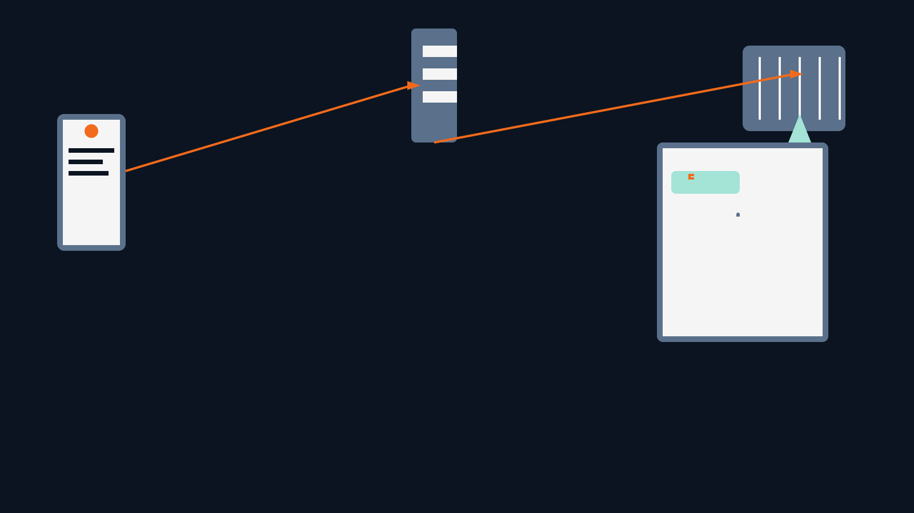

# Антифрод‑2026: как меняются схемы, какие сигналы указывают на угрозу и где границы детектирования

**Лид.** За последние полгода в России наблюдается ускоренный переход мошенников от традиционных телефонных звонков к более изощрённым схемам, использующим социальную инженерию в цифровой среде. Операторы связи, крупные маркетплейсы и центральный банк внедряют новые технологические решения – от анализа метаданных звонков до обмена тревожными сигналами между банками. Тем не менее, даже самые продвинутые системы остаются уязвимыми в точке первого контакта с жертвой. В статье рассматриваем механики современных схем, типичные индикаторы, способы раннего предупреждения и фундаментальные ограничения детектирования.

## 1. Эволюция схем: от телефонного фрода к «угону аккаунтов»

Традиционный телефонный фрод, когда злоумышленник выдает себя за сотрудника банка и требует перевод средств, в 2026 году уже не является доминирующим каналом. По данным аналитического блога **sostav.ru**, количество телефонных мошеннических звонков сократилось в несколько раз после внедрения автоматической фильтрации и массового просвещения населения. Однако снижение количества звонков не привело к исчезновению угроз: мошенники перенаправили усилия в более «мягкие» каналы коммуникации.

Главным вектором стала социальная инженерия в личных переписках. Как отмечает специалист по предотвращению мошенничества Сергей Хренов в интервью для **bezformata.com**, в период распродаж (11 ноября, «Чёрная пятница») злоумышленники массово рассылают ссылки на поддельные страницы скидок через мессенджеры и соцсети. Получатель видит сообщение от «знакомого», поэтому уровень подозрительности падает. Основная цель – захват учётных данных, после чего происходит «угон аккаунта», а не прямая кража банковских карт.

Сдвиг векторa атак объясняется тем, что взломать банковскую инфраструктуру технически стало сложнее, а «взломить» доверие человека – проще. В этом контексте культура цифровой безопасности, о которой пишет **sostav.ru**, приобретает значение не только для компаний, но и для каждого пользователя: критическое мышление и привычка проверять номер звонка или ссылку становятся первой линией обороны.

## 2. Точки входа в онлайн‑торговле: от регистрации до чата

Маркетплейсы уже давно используют антифрод‑модели, проверяющие платежные данные. Однако, как показал расследование **ru-bezh.ru**, Ozon в 2026 году выявил более 322 тысяч подозрительных заказов на сумму 11,4 млрд рублей. Примечательно, что большинство инцидентов фиксировалось **до** момента оплаты. Система начала проверку уже на этапе создания нового аккаунта: анализ IP‑адреса, сопоставление с черными списками, проверка поведения при заполнении формы.

Дальнейшая цепочка атак разворачивается в чатах между покупателем и продавцом. Злоумышленники, получив доступ к аккаунту, могут отправлять покупателям поддельные ссылки на оплату, а также использовать функции «сообщения от имени продавца» для рассылки фишинговых материалов. Оценка Ozon показывает, что около 200 мошеннических приложений были заблокированы, а более 11 тыс. подозрительных сообщений удалено из диалогов.

Эти данные подтверждают, что современный антифрод уже не ограничивается проверкой финансовой транзакции. Он охватывает весь жизненный цикл заказа: от регистрации, через коммуникацию, до финального расчёта. Поэтому индикаторы, такие как аномальное количество регистраций с одного устройства, частые смены пароля и несоответствие геолокации, становятся критически важными.

## 3. Телеком‑антифрод: раннее предупреждение по сигналам звонка

Национальный банк Казахстана (Нацбанк) совместно с операторами связи и банками реализует пилотный проект «Телеком Антифрод», о котором сообщает **zakon.kz**. Система собирает технические метаданные телефонных вызовов (номер вызывающего, длительность, тип сети) и применяет машинное обучение для выявления характерных признаков мошеннических обзвонов: быстрый набор цифр, повторяющиеся паттерны, отсутствие ответа на запросы о подтверждении личности.

Главное преимущество – передача тревожного сигнала банку **ещё до** того, как клиент совершит перевод. По данным проекта, уже предотвращено операций на сумму 132 млрд тенге. Такой подход закрывает «промежуток» между первым контактом и переводом средств, который традиционно оставался «слепой зоной» для большинства антифрод‑систем.

Однако эффективность проекта зависит от качества данных и скорости их передачи. Операторы обязаны обеспечить минимальную задержку в несколько секунд, иначе сигнал может прийти уже после завершения транзакции. Кроме того, алгоритмы должны балансировать между чувствительностью (чтобы не пропустить реальную атаку) и специфичностью (чтобы не генерировать избыточные ложные срабатывания, которые могут привести к «аллергии» у банков).

## 4. Индикаторы и сигналы в банковской экосистеме: аналитика и обмен данными

С ростом количества точек входа в мошенническую цепочку возрастает роль обмена информацией между участниками финансового рынка. Как подчёркивается в комментариях к статье на **habr.com**, предлагается обязательное возвращение жертвам средств, что влечёт за собой более жёсткую политику по блокировке подозрительных операций. При этом банки и операторы связи вынуждены усиливать свои антифрод‑механизмы, чтобы избежать штрафов и репутационных потерь.

Ключевые индикаторы, используемые в современных системах, включают:

* **Поведенческие аномалии** – резкое увеличение количества запросов на смену пароля, частые попытки входа с разных геолокаций, необычное время активности.
* **Технические признаки** – использование прокси‑серверов, VPN, а также несовпадение отпечатков браузера (User‑Agent) и реального устройства.
* **Социальные сигналы** – появление новых контактов в телефонных книгах, массовая рассылка одинаковых сообщений в мессенджерах, ссылки с короткими URL‑сервисами.

Для их обработки банки применяют гибридные модели: правила‑базированные фильтры в сочетании с нейронными сетями, обученными на исторических данных о мошенничестве. Обмен тревожными сигналами происходит через единую платформу, где каждый участник (оператор, платёжный шлюз, маркетплейс) может загрузить «индикаторный пакет» – набор параметров, характерных для текущей атаки. Это ускоряет реакцию и позволяет блокировать схему уже на ранних стадиях.

## 5. Ограничения детектирования и роль человеческого фактора

Несмотря на технологический прогресс, полностью автоматизировать защиту невозможно. Основные ограничения:

1. **Скорость человеческой реакции**. Даже если система генерирует сигнал, пользователь должен решить, доверять ли ей. Как пишет **sostav.ru**, критическое мышление и привычка «положить трубку» остаются единственными гарантиями в случае телефонного фрода.
2. **Объём ложных срабатываний**. Слишком чувствительные алгоритмы приводят к блокировке легитимных операций, что ухудшает клиентский опыт и подрывает доверие к системе.
3. **Эволюция тактик мошенников**. Злоумышленники постоянно меняют сценарии, используют новые каналы (например, голосовые помощники) и внедряют «deep‑fake» голоса, что усложняет построение устойчивых правил.
4. **Разобщённость данных**. Несмотря на инициативы по обмену информацией, в реальности многие организации работают в «силосах», что замедляет выявление кросс‑платформенных атак.

Поэтому эксперты подчеркивают, что технологии должны сочетаться с просвещением населения и постоянным обновлением нормативной базы. Третий и четвёртый пакеты антифрод‑мер, о которых упоминает **sostav.ru**, вероятно, будут включать более строгие требования к обмену данными и обязательные процедуры проверки личности в реальном времени.

**Итоги.** Современный антифрод в России и соседних странах представляет собой многослойную систему, где технологические решения (анализ звонков, поведенческий мониторинг, обмен индикаторами) работают в паре с культурой цифровой безопасности. Схемы мошенничества уже не ограничиваются простыми телефонными звонками, а охватывают весь путь пользователя от регистрации в онлайн‑сервисе до завершения финансовой транзакции. Ограничения детектирования – человеческий фактор, ложные срабатывания и разобщённость данных – остаются главными вызовами, требующими комплексного подхода и постоянного диалога между банками, операторами связи и регуляторами.

## Источники
- [«Маскарад по телефону»: как новые антифрод-меры 2026 года меняют правила игры и почему одного закона недостаточно](https://www.sostav.ru/blogs/287747/79301)
- [Новые схемы мошенничества в период распродаж | 13.11.2026 | Новости Горно-Алтайска - БезФормата](https://gornoaltaysk.bezformata.com/listnews/v-period-rasprodazh/165811460?amp=1)
- [Ozon выявил подозрительные заказы на 11,4 млрд рублей: почему антифрод маркетплейса начинается до оплаты | RUБЕЖ - 25.10.2026](https://ru-bezh.ru/kompanii-i-ryinki/news/26/10/23/ozon-vyyavil-podozritelnye-zakazy-na-114-mlrd-rubley-pochemu-ant)
- [Как защитить деньги от мошенников: Нацбанк намерен опережать преступников ᐈ zakon.kz](https://www.zakon.kz/amp/finansy/6538793-kak-zashchitit-dengi-ot-moshennikov-natsbank-nameren-operezhat-prestupnikov.html)
- [Минцифры предложило обязать банки и операторов связи возвращать деньги жертвам мошенников / Comments / Habr](https://habr.com/en/articles/1023658/comments)
- [Мошенники на сайтах знакомств. Как распознать афериста и защитить себя? - Российская газета](https://rg.ru/2026/11/18/pochti-15-procentov-aktivnyh-anket-na-dejting-ploshchadkah-kontroliruiut-moshenniki.html)
- [Как защитить деньги от мошенников: Нацбанк намерен опережать ...](https://www.instagram.com/p/Dfzs2f6AY7v)
- [В Москве прошел карьерный форум-выставка «Город. Карьера. Бизнес» / Новости города / Сайт Москвы](https://www.mos.ru/news/item/178657073)
- [Вакансия Руководитель службы фрод и транзакционного мониторинга в Москве, работа в компании Расчетная Небанковская Кредитная организация Платапэй](https://hh.ru/vacancy/139479625)
- [Антифрод аналитик (транзакционный антифрод) в F6 | Hirify](https://hirify.me/jobs/1241638-transaction-fraud-analyst)
- [Еще больше новостей в наших социальных сетях! ...](https://www.tiktok.com/@atamekenbusiness/video/7709420531677711637)
- [Мошенники на распродажах крадут не карты, а аккаунты](https://news.mail.ru/society/73057531)
- [ОСАГО получит новый адрес: в России готовят продажу полисов через "Госуслуги" без отказов](https://prospect.com.ru/news/7178295/osago-poluchit-novyj-adres-v-rossii-gotovyat-prodagu-polisov-cherez-gosuslugi-bez-otkazov.html)
- [Истории из жизни... - Про мошенников. АРБ](https://arb.ru/b2c/scrammers/istorii_iz_zhizni_-10666381)
- [Как мошенникам удается обмануть образованных людей?](https://zanmedia.kz/kak-moshennikam-udaetsya-obmanut-obra/168507)
- [Вакансия антифрод-аналитик в микрофинансировании ...](https://hirehi.ru/analytics/antifrod-analitik-v-mikrofinansirovanii-245529)
