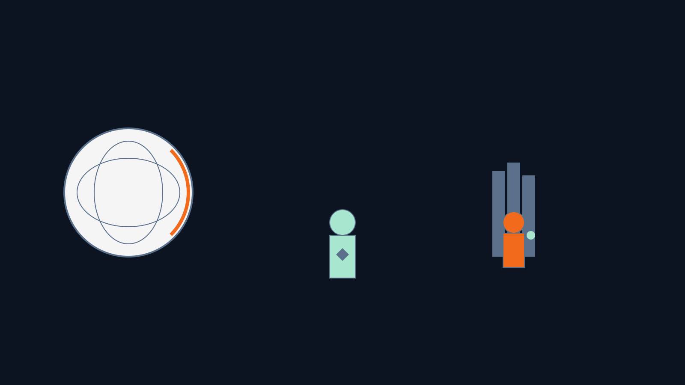

# Новости 18 ноября 2026: климатический контроль, новое руководство в ЦАР и тревога за детей в Йемене

18 ноября 2026 г. в официальных заявлениях Европейской комиссии, ООН и ЮНИСЕФ зафиксированы три события, которые отражают текущее состояние глобального климатического контроля, изменения в миротворческой миссии в Центральноафриканской Республике и рост гуманитарного кризиса в Йемене. Ниже — подробный разбор каждого из них и их возможные последствия для международного сообщества.

## Второй глобальный пересчёт (GST2) на COP31: оценка прогресса и вызовы

18 ноября в Анталье, Турция, в рамках 31‑й конференции сторон Рамочной конвенции ООН об изменении климата (COP31) Комиссар Европейской комиссии по климату Хоекстра выступил с докладом, посвящённым запуску Второго глобального пересчёта (GST2). По его словам, GST2 — «реальная проверка», позволяющая одновременно признать достигнутый прогресс и откровенно указать на те области, где усилий недостаточно.

GST, как предусмотрено Парижским соглашением, проводится каждые пять лет и служит механизмом коллективной оценки того, насколько страны приближаются к цели удержать глобальное потепление ниже 2 °C и стремятся к 1,5 °C. В своём выступлении Хоекстра подчеркнул, что текущие национальные вклады (NDC) в целом показывают рост амбициозности, однако разрыв между заявленными целями и реальными выбросами остаётся значительным.

Комиссия призвала к повышенной прозрачности в расчётах, к использованию независимых проверок данных и к более активному включению развивающихся стран в процесс финансирования климатических проектов. По мнению Европейской комиссии, именно такие меры позволят превратить GST2 из формального отчёта в инструмент, способный стимулировать конкретные политические решения.

## Новый специальный представитель ООН в ЦАР: Мохамед Аг Аёя

В тот же день Генеральный секретарь ООН Антонио Гутерреш объявил о назначении Мохамеда Аг Аёя из Мали на пост специального представителя ООН в Центральноафриканской Республике (ЦАР) и руководителя Многосторонственной интегрированной стабилизационной миссии ООН в ЦАР (MINUSCA).

Назначение подтверждает приверженность ООН поддерживать политическую стабильность в стране, где с 2014 года продолжаются вооружённые конфликты, сопровождающиеся массовыми перемещениями населения и нарушениями прав человека. MINUSCA, созданная резолюцией Совета Безопасности ООН 2670 (2014), имеет мандат защищать гражданское население, содействовать процессу национального примирения и поддерживать восстановление государственных институтов.

Гутерреш отметил, что опыт Аёя в миротворческих операциях и его знание регионального контекста позволят усилить координацию между международными и африканскими структурами, а также повысить эффективность реагирования на новые вспышки насилия. Ожидается, что под его руководством миссия сосредоточится на укреплении безопасности в центральных и северных провинциях, где активизировались вооружённые группы.

## Дети в Йемене: рост смертности в условиях обострения конфликта

UNICEF в своём еженедельном докладе от 18 ноября 2026 г. сообщил о «десятках» новых смертей детей в Йемене, где продолжаются боевые действия между силами Хути и правительственными войсками. По данным агентства, конфликт уже приближается к трёхмесячному рубежу с момента нового обострения, начавшегося в начале августа.

В заявлении UNICEF подчёркнуло, что дети становятся «неизбирательными жертвами» из‑за применения тяжёлого вооружения в густонаселённых районах, а также из‑за разрушения медицинской инфраструктуры, что ограничивает доступ к экстренной помощи. Агентство призвало все стороны конфликта соблюдать международные нормы, защищающие гражданское население, и обеспечить безопасные коридоры для гуманитарных поставок.

Ситуация в Йемене остаётся одной из самых тяжёлых гуманитарных кризисов в мире: более 30 млн человек нуждаются в продовольственной помощи, а более 20 млн находятся в условиях острой продовольственной нехватки. Увеличение числа детских жертв усиливает давление на международные организации и страны‑доноры, вынуждая их пересматривать объёмы и формы помощи.

## Перспективы международного реагирования и координации

Три события, озвученные 18 ноября, демонстрируют, насколько разнообразными являются вызовы, стоящие перед глобальными институтами. Запуск GST2 подчёркивает необходимость более строгой проверки климатических обязательств и, по мнению Европейской комиссии, может стать катализатором для пересмотра национальных планов снижения выбросов.

Назначение Мохамеда Аг Аёя в ЦАР указывает на продолжающуюся роль ООН в управлении конфликтами, где политическая легитимность и региональная экспертиза считаются ключевыми факторами успеха миротворческих миссий.

Одновременно с этим, отчёт UNICEF о росте детных смертей в Йемене усиливает требование к международному сообществу не только оказывать гуманитарную помощь, но и оказывать давление на конфликтующие стороны с целью соблюдения международного гуманитарного права.

В совокупности эти новости подчеркивают важность синхронного подхода: климатическая политика, миротворчество и гуманитарная помощь должны рассматриваться как взаимосвязанные элементы глобальной безопасности. Предстоящие встречи в рамках ООН, ЕС и региональных форумов могут стать площадкой для согласования действий, обмена ресурсами и разработки совместных стратегий, направленных на снижение климатических рисков, укрепление мира в Африке и защиту самых уязвимых групп населения.

## Источники
- [Remarks by Commissioner Hoekstra during Ministerial High-Level event on the launch of the Second Global Stocktake at COP31](https://ec.europa.eu/commission/presscorner/detail/en/speech_26_2510)
- [Secretary-General Appoints Mohamed Ag Ayoya of Mali Special Representative, Head of UN Multidimensional Integrated Stabilization Mission in Central African Republic](https://press.un.org/en/2026/sga2452.doc.htm)
- [Dozens more children killed in Yemen amid escalating hostilities](https://news.un.org/feed/view/en/story/2026/11/1168830)
