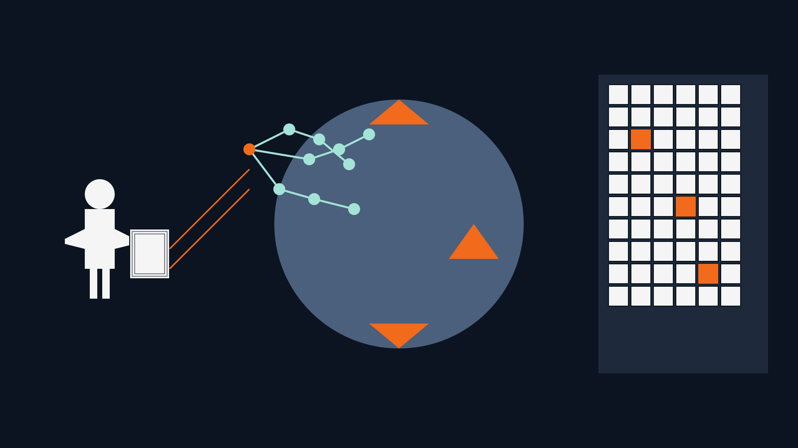

# Как построить эффективную AML‑программу, опираясь на стандарты FATF

Практический разбор для руководителей комплаенса, внутреннего контроля и бизнеса: от оценки рисков до внедрения технологий и формирования культуры соблюдения.

В условиях усиления международных требований к противодействию отмыванию доходов и финансированию терроризма, организации любого масштаба вынуждены ориентироваться на глобальные стандарты, сформулированные Финансовой группой действий (FATF). Несмотря на то, что FATF — межправительственная организация, созданная в 1989 году инициативой G7, — её рекомендации стали de‑facto обязательными для большинства юрисдикций. В статье рассматривается, как руководители комплаенса могут превратить абстрактные требования в работающий внутрикорпоративный процесс, минимизировать операционные издержки и избежать санкций.

## 1. FATF как стратегический ориентир: что нужно знать руководителю

FATF возглавляет глобальные усилия по борьбе с отмыванием денег, финансированием терроризма и распространением оружия массового уничтожения. Организация разрабатывает международные стандарты (Recommendations), проводит взаимные оценки (mutual evaluations) и поддерживает «чёрный список» стран с высоким уровнем риска. На сегодняшний день в FATF входит 40 членов, представляющих более 80 % мирового ВВП, а её рекомендации признаны обязательными в национальном законодательстве большинства стран‑участниц.

Для комплаенс‑руководителя это означает, что любые отклонения от требований FATF могут привести к репутационным и финансовым потерям: ограничения доступа к международным финансовым рынкам, рост стоимости привлечения капитала и усиленный контроль со стороны регуляторов. Поэтому первым шагом является формальное признание FATF‑стандарта в корпоративных политиках и в системе внутреннего контроля.

## 2. Риск‑ориентированная модель AML: построение и адаптация

Стандарт FATF подчёркивает необходимость применения риск‑ориентированного подхода. Это требует систематической оценки рисков, связанных с клиентами, продуктами, каналами доставки и географией операций. Практический процесс выглядит так:

1. **Идентификация факторов риска** – используйте публичные списки FATF (например, список стран с высоким уровнем риска) и отраслевые индикаторы (сектор с высоким уровнем наличных операций, криптовалютные сервисы).
2. **Квантование риска** – присвойте каждому фактору баллы, сформируйте агрегированный показатель для клиента/транзакции.
3. **Сегментация** – разделите базу на группы «низкий», «средний» и «высокий» риск, определив пороги, при которых требуется усиленный мониторинг.
4. **Разработка мер контроля** – для каждой группы установите соответствующий уровень проверки (от базовой верификации до полного due‑diligence).
5. **Регулярный пересмотр** – обновляйте оценку не реже чем раз в год или при изменении профиля клиента.

Эта модель позволяет сосредоточить ресурсы на действительно опасных сценариях, а не тратить их на массовый контроль, что подтверждается рекомендациями FATF о пропорциональном распределении усилий.

## 3. Взаимные оценки FATF: как подготовиться к проверке и избежать «чёрного списка»

Каждые несколько лет FATF проводит взаимные оценки стран‑членов, проверяя их соответствие 40 рекомендациям. Результаты влияют на включение стран в «чёрный список» (high‑risk jurisdictions) и могут стать основанием для санкций со стороны финансовых институтов.

Для компаний важно понимать, что оценка охватывает не только национальное законодательство, но и практику применения мер внутри организаций. Практические шаги подготовки:

- **Документирование политики** – все процедуры AML должны быть зафиксированы в официальных инструкциях, соответствующих рекомендациям FATF.
- **Аудит процессов** – проведите внутренний аудит, сравнив текущие практики с требованиями FATF; выявленные пробелы следует закрыть до начала официальной оценки.
- **Тестирование сценариев** – смоделируйте типичные схемы отмывания (например, «smurfing», «layering») и проверьте, способны ли ваши системы их выявлять.
- **Обучение персонала** – сотрудники, участвующие в клиентском обслуживании и мониторинге, должны знать, какие сигналы считаются подозрительными согласно FATF.

Эффективная подготовка к взаимным оценкам снижает вероятность попадания в «чёрный список», а значит, сохраняет доступ к международным финансовым каналам.

## 4. Технологический арсенал: от правил до искусственного интеллекта

Традиционные правила‑базированные системы мониторинга часто генерируют огромное количество ложных срабатываний, что приводит к «alert fatigue». FATF признаёт необходимость применения современных технологий, позволяющих повысить точность и скорость анализа.

- **Машинное обучение** – модели классификации обучаются на исторических данных о подозрительных и легитимных транзакциях, автоматически адаптируясь к новым схемам отмывания.
- **Сетевой анализ** – графовые базы данных позволяют выявлять скрытые связи между клиентами, контрагентами и транзакциями, что особенно ценно при работе с корпоративными клиентами и цепочками поставок.
- **Решения на базе облака** – гибкая инфраструктура обеспечивает масштабируемость при росте объёма данных и упрощает интеграцию с внешними источниками (например, списками санкций и PEP).
- **Автоматизация SAR** – системы автоматически формируют отчёты о подозрительных действиях (Suspicious Activity Report) в соответствии с форматом, требуемым регуляторами, сокращая ручной труд и повышая согласованность данных.

Внедрение этих технологий должно сопровождаться строгим управлением изменениями: тестирование моделей, документирование алгоритмов и обеспечение возможности объяснения решений (explainability), что является требованием FATF к прозрачности процессов.

## 5. Управление поставщиками и международными цепочками поставок

Комплаенс‑риски часто «просачиваются» через третьих лиц: поставщиков, субподрядчиков, финансовых посредников. FATF требует, чтобы организации проводили должную проверку (due‑diligence) своих контрагентов, особенно если они находятся в странах с повышенным уровнем риска.

- **Картирование цепочки поставок** – создайте реестр всех ключевых контрагентов, указав их юрисдикцию, профиль деятельности и уровень риска.
- **Контрольные списки** – используйте актуальные списки FATF и международных санкций для автоматической проверки новых и существующих поставщиков.
- **Контракты с клаузулами AML** – включайте в договоры обязательства по соблюдению анти‑отмывочных мер, право аудита и уведомления о подозрительных операциях.
- **Регулярный пересмотр** – обновляйте оценки риска поставщиков минимум раз в год или при изменении их бизнес‑модели.

Эти меры позволяют снизить вероятность использования компании в качестве «прокси» для отмывания средств, а также укрепляют позиции в переговорах с банками и инвесторами, которые всё чаще требуют доказательства надёжного управления третьими сторонами.

## 6. Культура комплаенса и постоянное обучение

Технические решения и формальные процедуры теряют эффективность без поддержки со стороны руководства и без понимания их важности сотрудниками. FATF подчёркивает роль культуры комплаенса как одного из столпов устойчивой системы AML.

- **Тон сверху** – руководство должно публично подтверждать приверженность требованиям FATF, включать их в стратегические цели и KPI.
- **Программы обучения** – разработайте модульные курсы, охватывающие базовые понятия отмывания, специфические риски отрасли и практические кейсы. Обновляйте материалы минимум раз в полугодие, учитывая новые схемы, выявленные в международных отчётах FATF.
- **Система поощрений и ответственности** – вводите премии за выявление подозрительных операций и чётко фиксируйте последствия за игнорирование требований.
- **Обратная связь** – создайте канал для анонимных сообщений о потенциальных нарушениях, гарантируя защиту информаторов.

Сильная культура комплаенса повышает вероятность своевременного обнаружения рисков и формирует репутационный буфер, который может стать решающим фактором в случае проверки со стороны регулятора.

Подводя итог, построение AML‑программы, основанной на рекомендациях FATF, требует сочетания риск‑ориентированного подхода, технологических решений, контроля над контрагентами и развития культуры комплаенса; только такой комплексный подход обеспечивает устойчивую защиту от финансовых преступлений и поддерживает доверие инвесторов и регуляторов.

## Источники
- [Financial Action Task Force](https://www.fatf-gafi.org/)
- [Financial Action Task Force - Wikipedia](https://en.wikipedia.org/wiki/Financial_Action_Task_Force)
- [Financial Action Task Force | U.S. Department of the Treasury](https://home.treasury.gov/policy-issues/terrorism-and-illicit-finance/financial-action-task-force)
