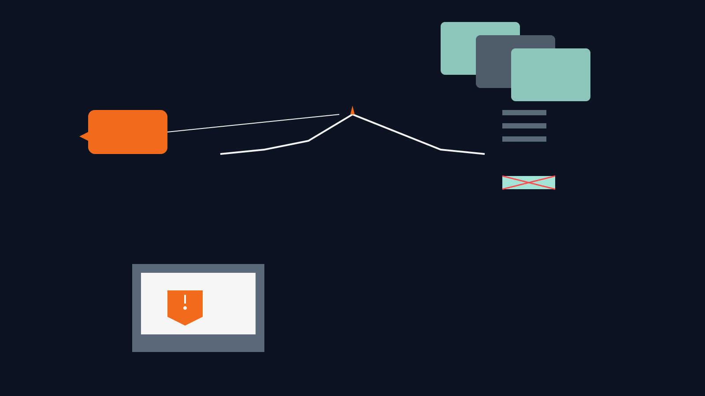

# Как работают схемы финансового мошенничества: механика, индикаторы и границы детекции

Финансовый сектор, будучи ядром современной экономики, привлекает к себе как законных участников, так и преступные группы, которые используют технологические возможности для извлечения выгоды. В статье рассматриваются типичные схемы мошенничества, признаки, позволяющие их выявлять, а также ограничения, с которыми сталкиваются аналитические системы в реальном времени.

## Схемы финансового мошенничества в цифровой среде

Современные схемы часто опираются на автоматизацию и масштабирование. Наиболее распространённые типы включают:

* **Pump‑and‑dump** – искусственное завышение цены акций через массовые публикации в соцсетях, после чего мошенники продают свои позиции, оставляя остальных инвесторов с убыточными бумагами.
* **Spoofing и layering** – размещение крупных ордеров на покупку или продажу, которые не предназначены к исполнению, с целью создания иллюзии спроса/предложения и манипуляции рыночными котировками. После изменения цены «фальшивые» заявки отменяются.
* **Фишинг и компрометация аккаунтов** – рассылка поддельных писем или сообщений, имитирующих официальные запросы банков, с целью получения доступа к клиентским данным и последующего несанкционированного перевода средств.
* **Синтетические идентичности** – комбинация реальных и вымышленных данных, позволяющая открыть новые счета без реального владельца, а затем использовать их для отмывания средств.

Все эти схемы используют фундаментальные свойства финансовой системы, описанные в открытых источниках как «управление, перемещение, инвестирование и привлечение денег» [Finance – Wikipedia]. Именно открытость рынков и возможность мгновенных транзакций создают благодатную почву для злоумышленников.

## Технические индикаторы и поведенческие сигналы

Для обнаружения подозрительных действий аналитики опираются на два уровня данных: рыночные (цены, объёмы) и клиентские (логины, транзакции). Ключевые индикаторы включают:

* **Аномальное соотношение объёма и цены** – резкое увеличение торгового объёма без соответствующего фундаментального драйвера часто указывает на spoofing.
* **Необычная география входов** – входы в аккаунт из стран, где клиент ранее не появлялся, повышают риск фишинга.
* **Повторяющиеся небольшие переводы** – характерный признак «размытия» средств в схемах синтетических идентичностей.
* **Временные паттерны** – активность в ночные часы, когда большинство пользователей спит, часто свидетельствует о автоматизированных бот‑атаках.

Эти сигналы фиксируются в системах мониторинга, которые используют правила и машинное обучение. Однако эффективность зависит от качества исходных данных; в открытых финансовых новостных лентах, таких как Yahoo Finance, часто фиксируются резкие колебания цены, которые могут служить триггером для дальнейшего анализа [Yahoo Finance].

## Практические меры предупреждения и реагирования

Организации внедряют многоуровневый подход:

1. **Контроль доступа** – многофакторная аутентификация и ограничение IP‑диапазонов снижают вероятность компрометации аккаунтов.
2. **Тестирование моделей** – регулярные стресс‑тесты детекционных алгоритмов на исторических аномалиях позволяют выявлять «слепые зоны».
3. **Обучение персонала** – сотрудники, работающие с клиентами, проходят тренинги по распознаванию фишинговых сообщений, что уменьшает человеческий фактор.
4. **Сотрудничество с регуляторами** – обмен информацией о новых схемах через отраслевые площадки ускоряет реакцию на появляющиеся угрозы.

Эти меры согласуются с общепринятыми практиками управления финансовыми рисками, описанными в словарных определениях финансов как «относящихся к деньгам или их управлению» [Cambridge Dictionary].

## Ограничения современных систем детектирования

Несмотря на продвинутые технологии, существуют фундаментальные ограничения:

* **Ложные срабатывания** – избыточная чувствительность к аномалиям приводит к блокировке легитимных операций, что ухудшает клиентский опыт.
* **Эвристика vs. адаптивность** – правила, построенные на известных схемах, не способны быстро реагировать на новые тактики, например, комбинирование фишинга с deep‑fake‑аутентификацией.
* **Недостаток данных** – в некоторых юрисдикциях ограничения на хранение и передачу персональных данных препятствуют построению полноценных моделей поведения.
* **Технические ограничения** – обработка в реальном времени больших потоков рыночных данных требует значительных вычислительных ресурсов; задержки могут привести к пропуску быстрых манипуляций, характерных для spoofing.

Эти факторы подчеркивают необходимость постоянного обновления методик и инвестиций в инфраструктуру, иначе системы останутся уязвимыми перед всё более изощрёнными мошенническими схемами.

## Источники
- [Yahoo Finance - Stock Market Live, Quotes, Business & Finance News](https://finance.yahoo.com/)
- [FINANCIAL | English meaning - Cambridge Dictionary](https://dictionary.cambridge.org/dictionary/english/financial)
- [Finance - Wikipedia](https://en.wikipedia.org/wiki/Finance)
- [Home - Financial Times](https://www.ft.com/)
- [Scattering of light - BYJU'S](https://byjus.com/physics/what-is-scattering-of-light/)
