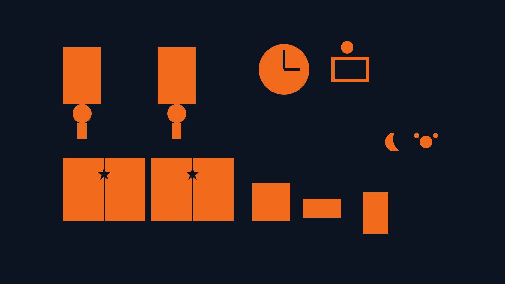

# Интересные факты об образовании детей в разных странах: школьный день, возраст начала обучения, учебный календарь и необычные практики

Школьные годы формируют не только знания, но и привычки, которые сопровождают человека всю жизнь. Несмотря на глобальную тенденцию к унификации учебных программ, детали организации обучения сильно различаются от страны к стране: от продолжительности школьного дня до даты начала занятий и от традиций домашнего обучения до экспериментальных методов преподавания. Ниже — восемь проверенных фактов, раскрывающих эти различия и показывающих, как национальные контексты влияют на образование детей.

## 1. Возраст начала обязательного обучения: от 3 до 7 лет

Во многих странах Европы и Северной Америки обязательное образование начинается в возрасте 5–6 лет. Например, в Финляндии дети поступают в начальную школу в сентябре, когда им исполняется 7 лет, а в США большинство штатов устанавливают старт в 5–6 лет. Однако в некоторых азиатских и африканских государствах обязательный школьный возраст снижен до 3–4 лет, что связано с политикой раннего развития и борьбы с отставанием в базовых навыках. По данным UNESCO Institute for Statistics, в 2023 году более 30 странах мира обязательное образование начинается не позже 5 лет, а в 12 странах — уже в 3 года, что отражает разнообразие национальных приоритетов в области детского развития.

**Почему так?** В странах с высоким уровнем дохода (например, Швеция, Германия) система дошкольного образования уже обеспечивает подготовку к школе, поэтому формальный старт откладывается. В государствах с ограниченными ресурсами (например, Нигерия, Камбоджа) ранний старт служит инструментом снижения уровня неграмотности, позволяя быстрее включать детей в систему обучения.

## 2. Длительность школьного дня: от 4 до 8 часов

Продолжительность учебного дня варьируется в зависимости от культурных традиций и педагогических подходов. В Японии ученики проводят в школе в среднем 7,5 часов, включая послеурочные занятия и клубные секции, что считается нормой для поддержания высокой академической успеваемости. В Финляндии, наоборот, школьный день обычно длится 4–5 часов, а акцент делается на самостоятельную работу и игровые методы.

OECD отмечает, что в странах с более коротким учебным днем (например, Дания, Нидерланды) показатели успеваемости часто сопоставимы с теми, где день длиннее, благодаря более гибкой организацией учебного процесса и большему времени для отдыха. Это подтверждает, что количество часов в школе не является единственным фактором качества образования.

## 3. Учебный календарь: традиционный годовой цикл vs. полугодовой режим

Большинство стран придерживаются традиционного учебного года, начинающегося в августе‑сентябре и заканчивающегося в мае‑июне. Однако в некоторых регионах применяется полугодовой календарь, который позволяет лучше адаптировать обучение к климатическим условиям.

В Австралии, где в разных штатах климат сильно различается, школы часто делят учебный год на два семестра с длительным летним перерывом в декабре‑феврале. В Саудовской Аравии учебный год начинается в сентябре, но из‑за жаркого лета занятия в июле‑августе заменяются дистанционными модулями. По данным UNICEF, такие гибкие модели помогают снизить уровень пропусков в школах, расположенных в экстремальных климатических зонах.

## 4. Обязательное домашнее обучение: закон или исключение?

В некоторых странах домашнее обучение (homeschooling) признано законным и регулируется государством, в других — считается редким явлением. В США более 2 млн детей обучаются дома, что составляет около 3 % всех школьников; законодательство штатов требует подачи ежегодных отчетов о прогрессе.

В Финляндии домашнее обучение официально запрещено: каждый ребенок обязан посещать школу, а родители, желающие обучать детей дома, должны получить специальное разрешение, которое практически не выдаётся. В России домашнее обучение допускается, но только при наличии индивидуального образовательного плана, согласованного с региональными органами образования. Эти различия отражают разные представления о роли школы как социального института.

## 5. Необычные педагогические практики: от «школы без стен» до «проектных школ»

Экспериментальные модели обучения активно внедряются в странах, стремящихся к инновациям. В Нидерландах существует сеть «школ без стен», где занятия проводятся в парках, музеях и на улицах города, а учебный процесс ориентирован на практический опыт.

В Южной Корее популярна система «проектных школ», где ученики работают над длительными междисциплинарными проектами, часто совместно с компаниями‑партнёрами. По данным OECD, такие модели способствуют развитию критического мышления и навыков сотрудничества, однако требуют высокой квалификации учителей и значительных инвестиций в инфраструктуру.

## 6. Продолжительность каникул: от коротких «зимних» до длительных «летних»

Продолжительность школьных каникул напрямую влияет на успеваемость и уровень стресса у детей. В Японии летние каникулы длятся лишь 2‑3 недели, а в Финляндии — около 10 недель, включая осенний и весенний перерывы.

Исследования UNICEF показывают, что более длительные летние каникулы могут приводить к «летнему разрыву» в знаниях, особенно у детей из малообеспеченных семей, которым недоступны летние образовательные программы. В ответ на это в Канаде и Австралии развиваются программы летних школ, предоставляющие бесплатные занятия по математике и чтению.

## 7. Инклюзивное образование: степень реализации в разных регионах

Инклюзия детей с ограниченными возможностями остаётся одной из главных задач глобального образования. По данным UNESCO, в 2022 году только 44 % стран имели национальные политики, гарантирующие полную инклюзию в общеобразовательных школах.

В Швеции и Канаде инклюзивные практики реализованы почти в полном объёме: специальные помощники, адаптированные учебные материалы и гибкие графики являются нормой. В странах Ближнего Востока (например, Иордания) инклюзия только начинает развиваться, и большинство детей с особыми потребностями продолжают обучаться в специализированных учреждениях.

## 8. Технологическое оснащение классов: от планшетов до искусственного интеллекта

Цифровизация школ происходит с разной скоростью. В Южной Корее почти каждый ученик получает планшет, а учебные программы интегрируют искусственный интеллект для адаптивного подбора заданий. В Финляндии акцент делается на баланс: технологии используются как вспомогательный инструмент, но основной упор остаётся на диалог и коллективную работу.

OECD отмечает, что страны, инвестирующие в инфраструктуру ИТ и обучающие учителей работать с цифровыми инструментами, демонстрируют более высокие результаты в международных тестах (PISA). Однако без соответствующей педагогической подготовки технологии могут стать лишь «электронным шумом», не повышая качества обучения.

## Заключение

Разнообразие школьных систем мира показывает, что нет единого рецепта «идеального» образования. Возраст начала обучения, длительность учебного дня, календарь, формы домашнего обучения и технологическое оснащение — всё это отражает исторические, культурные и экономические особенности каждой страны. Общим же фактором остаётся стремление обеспечить каждому ребёнку возможность учиться и развиваться, независимо от места рождения. Понимание этих различий помогает политикам и педагогам находить лучшие практики и адаптировать их к локальным условиям, делая образование более гибким, инклюзивным и эффективным.

## Источники
- [UNESCO Institute for Statistics — Education](https://uis.unesco.org/en/topic/education)
- [OECD — Education](https://www.oecd.org/en/topics/education.html)
- [UNICEF — Education](https://www.unicef.org/education)
