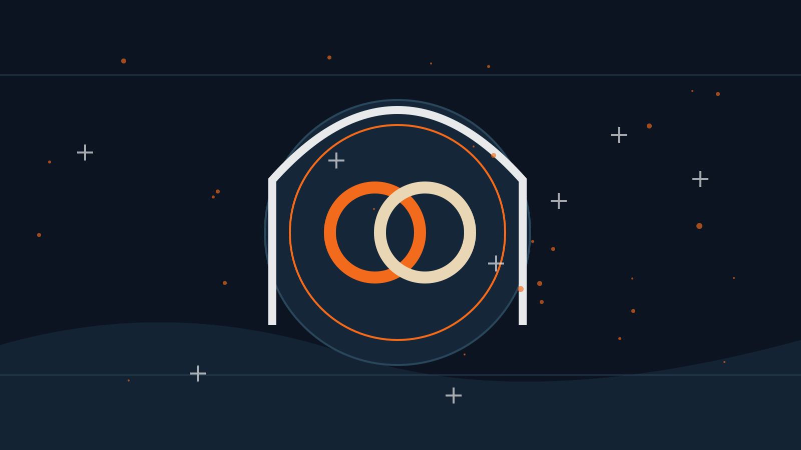

# Как построить гибкую систему комплаенса в условиях меняющегося AML‑риска

В условиях ускоренного обновления списков «высокорисковых» стран и роста трансграничных финансовых потоков руководители отделов комплаенса сталкиваются с необходимостью быстро адаптировать свои программы к новым требованиям, не теряя эффективности контроля. В статье рассматриваются практические шаги, которые помогут построить гибкую, но надёжную систему AML/CFT, опираясь на последние рекомендации британского казначейства, данные FinCEN о странах‑проблемах и аналитический отчёт Европейского банковского регулятора.

## 1. Оценка текущего риска: от списка стран к динамичной матрице

Традиционный подход к AML‑риску в компаниях часто базируется на статических списках «высокорисковых» юрисдикций. Однако в октябре‑ноябре 2026 года такие списки претерпели значительные изменения. По данным **HM Treasury** в «Money Laundering Advisory Notice» (модификация от 11 ноября 2026 г.) добавлены новые государства, где наблюдается рост финансирования терроризма и отмывания средств, а некоторые ранее включённые страны сняты после проведения реформ.

FinCEN в своём релизе «FATF identifies jurisdictions with AML/CFT deficiencies» (октябрь 2026) подтверждает, что более 20 % стран, ранее не входивших в список, теперь требуют повышенного контроля из‑за недостатков в реализации рекомендаций FATF.

Эти изменения делают невозможным полагаться лишь на один‑разовый перечень. Руководителю комплаенса следует построить **динамичную матрицу риска**, включающую:

| Параметр | Источник данных | Период обновления |
|----------|----------------|-------------------|
| Статус страны в списке FATF | FinCEN, EBA | ежемесячно |
| Оценка финансовой прозрачности | HM Treasury, EBA | ежеквартально |
| Секторные риски (некоммерческие, крипто‑сервисы) | Внутренний мониторинг | в режиме реального времени |

Матрица должна быть интегрирована в систему управления рисками (GRC) и автоматически пересчитывать уровень риска при изменении любого из параметров. Такой подход позволяет быстро реагировать на появление новых «горячих» юрисдикций без необходимости полного пересмотра политики.

## 2. Пересмотр процедур клиентского дью‑дилидженса (CDD)

С учётом расширения списка стран‑рисков, процедуры CDD требуют более детального сегментирования клиентов. Европейский банковский регулятор (EBA) в «Risk Assessment Report – Autumn 2026» отмечает, что **повышенный уровень детализации верификации** снижает вероятность пропуска подозрительных транзакций, особенно в мульти‑юрисдикционных цепочках.

Практические рекомендации:

1. **Классификация клиентов по уровню риска** – три уровня (низкий, средний, высокий). Для клиентов из стран, отмеченных в последнем Advisory Notice, сразу назначается высокий уровень.
2. **Углублённый сбор информации** – помимо стандартных данных (паспорт, ИНН) требуется подтверждение источника средств через банковские выписки за последние 12 мес., а также независимую проверку через публичные реестры бенефициарных владельцев.
3. **Периодический пересмотр** – для клиентов высокого риска CDD проводится минимум раз в полугодие, а при изменении их географии или бизнес‑модели – немедленно.

Внедрение автоматизированных решений (KYC‑платформы с поддержкой API к международным базам) позволяет сократить ручной труд и обеспечить соответствие требованиям в режиме near‑real‑time.

## 3. Мониторинг транзакций: от правил‑базовых фильтров к машинному обучению

Традиционный мониторинг AML базируется на статических правилах (например, «транзакция > 10 000 USD в страну‑риска»). По мнению экспертов EBA, такие правила часто генерируют **ложные срабатывания**, перегружая аналитиков.

Новые рекомендации включают:

- **Гибридный подход**: сочетание правил‑базовых фильтров с моделями машинного обучения, обученными на исторических данных компании.
- **Обучение моделей на актуальных списках**: при каждом обновлении списка стран‑рисков модели переобучаются, учитывая новые корреляции (например, рост транзакций через криптовалютные шлюзы, связанные с определёнными юрисдикциями).
- **Контекстуальная аналитика**: система должна учитывать не только сумму, но и частоту, контрагентов, тип продукта и сезонные особенности.

FinCEN подчёркивает, что **интеграция аналитики поведения** (behavioral analytics) позволяет выявлять схемы «разбивки» (smurfing) и «структурирования» (layering) даже при небольших суммах, если они повторяются в короткие интервалы.

Для практической реализации рекомендуется использовать готовые решения от проверенных поставщиков (например, SAS AML, FICO TONBELLER) с возможностью кастомизации правил под локальные требования.

## 4. Управление инцидентами и отчётность: от реактивности к проактивному контролю

Последний этап цепочки комплаенса – эффективное реагирование на выявленные подозрения и своевременная отчётность перед регуляторами. В «Money Laundering Advisory Notice» указано, что **сокращение времени от обнаружения до подачи SAR (Suspicious Activity Report)** до 48 часов считается лучшей практикой.

Ключевые шаги:

1. **Единый центр инцидентов (SOC AML)** – централизованная команда, получающая сигналы от мониторинга, проводящая первичный анализ и эскалацию.
2. **Стандартизированные шаблоны SAR** – автоматическое заполнение полей на основе данных из GRC и KYC, что уменьшает риск ошибок.
3. **Регулярные тренинги** – сотрудники должны проходить обучение не реже чем раз в полгода, включая сценарии новых схем отмывания, описанные в последних выпусках EBA.
4. **Обратная связь в систему контроля** – каждый закрытый инцидент должен вноситься в базу знаний, чтобы модели машинного обучения учитывали новые типы поведения.

Проактивный контроль подразумевает также **периодический аудит** внутренней политики. По рекомендациям HM Treasury, аудит следует проводить минимум раз в год, а в случае значимых изменений в списках стран‑рисков – немедленно.

## 5. Культура комплаенса: от обязательства к стратегическому активу

Технические меры работают лишь в том случае, если они поддерживаются корпоративной культурой. EBA в своём отчёте подчёркивает, что **высокий уровень приверженности руководства** к комплаенсу коррелирует с уменьшением количества нарушений.

Практические инструменты формирования культуры:

- **Коммуникация от топ‑менеджмента** – регулярные сообщения о важности AML/CFT, подкреплённые примерами реальных кейсов.
- **Внедрение KPI** – включение показателей комплаенса (например, % своевременно поданных SAR) в систему вознаграждения руководителей.
- **Прозрачность процессов** – открытый доступ к политике AML для всех сотрудников, возможность анонимного сообщения о подозрениях.

Создание «комплаенс‑марафона» внутри компании, где отделы соревнуются в снижении количества ложных срабатываний, способствует повышению вовлечённости и улучшает общую эффективность программы.

---

## Источники
- [HM Treasury: Money Laundering Advisory Notice, November 2026](https://www.gov.uk/government/publications/money-laundering-advisory-notice-high-risk-third-countries--2/money-laundering-advisory-notice-high-risk-third-countries--2)
- [FinCEN: FATF identifies jurisdictions with AML/CFT deficiencies, October 2026](https://www.fincen.gov/news/news-releases/financial-action-task-force-identifies-jurisdictions-anti-money-laundering-6/)
- [European Banking Authority: Risk Assessment Report, Autumn 2026](https://www.eba.europa.eu/publications-and-media/publications/risk-assessment-report-autumn-2026)
