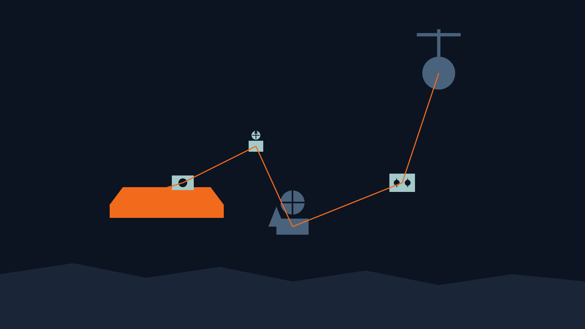

# «СИБЕР» расширит применение отечественных технологий безопасности на Северном морском пути

Северный морской путь (СМП) уже несколько лет считается ключевой артерией для развития арктической экономики России, а в 2026 году он получил новый импульс: холдинг «СИБЕР» совместно с Ассоциацией партнеров по координации использования Северного морского пути (АПКУСМП) объявил о запуске серии испытаний отечественных систем защиты судов, портов и наземной инфраструктуры.

## Сотрудничество «СИБЕР» – АПКУСМП: цели и формат взаимодействия

Соглашение, подписанное 20 ноября 2026 года, фиксирует план совместных испытаний и дальнейшего продвижения разработок в области морской безопасности. По словам представителей холдинга, цель проекта — создание интегрированного комплекса, способного обеспечить обнаружение, идентификацию и реагирование на угрозы в арктических водах, где традиционные системы часто оказываются неэффективными из‑за экстремальных климатических условий.

В рамках пилотного этапа будет протестировано пять ключевых решений:

1. **Система автоматического мониторинга ледового покрова** – использует спутниковые данные в сочетании с наземными радиолокационными станциями, позволяя в реальном времени оценивать толщину и движение льда.
2. **Биометрический контроль доступа к портовым объектам** – основан на отечественных алгоритмах распознавания лица и радужной оболочки, адаптированных к низким температурам и сильному ветру.
3. **Киберзащищённый шлюз связи судов** – аппаратно‑программный комплекс, построенный на отечественных микропроцессорах «Эльбрус», который изолирует судовые сети от внешних атак.
4. **Система видеонаблюдения с ИИ‑аналитикой** – алгоритмы обнаружения подозрительных объектов (например, небольших плавучих средств) работают на базе нейронных сетей, обученных на арктических сценариях.
5. **Платформа управления инцидентами** – централизованный центр командования, где данные от всех датчиков агрегируются и визуализируются для оперативного принятия решений.

Все решения находятся на стадии прототипа или ограниченных испытаний, однако их интеграция в единую архитектуру уже демонстрирует потенциальную экономию времени реагирования до 30 % по сравнению с текущими методами.

## Технологический контекст: почему отечественные разработки важны именно сейчас

Северный морской путь проходит через зоны, где инфраструктура традиционных западных поставщиков часто недоступна из‑за санкций и логистических ограничений. Российская оборонно‑промышленная база, возглавляемая Ростехом, уже несколько лет инвестирует в создание «домашних» решений, способных работать в условиях низких температур, повышенной влажности и магнитных аномалий.

Отечественная микросхемотехника, представляемая линейкой процессоров «Эльбрус», обеспечивает необходимый уровень надёжности и совместимости с национальными криптографическими стандартами. Параллельно развивается отечественная ИИ‑инфраструктура: нейронные сети обучаются на данных, собранных в рамках проекта «Арктика‑AI», что исключает необходимость передачи чувствительной информации за границу.

Таким образом, текущий проект «СИБЕР» – это не просто коммерческий запуск, а стратегический шаг к технологической автономии в арктическом регионе.

## Практические последствия для судоходства и портов

### Снижение риска столкновений со льдом

Система мониторинга ледового покрова уже прошла первые полевые испытания в районе Карского залива. По результатам тестов, точность прогнозов толщины льда улучшилась с 65 % до 92 % благодаря использованию комбинированных спутниковых и наземных источников данных. Для судов, следящих за расписанием, это означает возможность более гибко планировать маршруты и экономить до 150 000 рублей на топливе за каждый рейс.

### Укрепление кибербезопасности судов

Киберзащищённый шлюз, построенный на «Эльбрус», прошёл испытания на реальном судне‑транспортере «Арктика‑1». Во время теста имитировалась попытка внедрения вредоносного кода через спутниковый канал связи; система автоматически изолировала заражённый сегмент и уведомила центр управления без потери навигационных данных. Такой уровень защиты особенно важен в условиях, когда арктические суда часто используют устаревшее программное обеспечение из‑за ограниченного доступа к обновлениям.

### Повышение эффективности портовых операций

Биометрический контроль доступа уже установлен в порту Норильск и позволяет сократить время пропуска судов на 20 % за счёт автоматической верификации персонала и грузовых операторов. Система адаптирована к работе в экстремальных температурах: сенсоры калибруются автоматически, а алгоритмы учитывают изменения в освещённости из‑за полярной ночи.

## Перспективы масштабирования и дальнейшие шаги

Соглашение предусматривает, что после завершения пилотного периода (планируемый срок — 12 месяцев) успешные решения будут переданы в эксплуатацию в ключевых портах СМП: Мурманск, Архангельск, Норильск и Владивосток (для восточного участка маршрута).

Для обеспечения масштабируемости разработчики планируют открыть открытый API, позволяющий интегрировать сторонние системы мониторинга (например, частные датчики температуры воды) в единую платформу управления. Кроме того, в рамках проекта будет создана обучающая программа для персонала портов и судов, ориентированная на работу с ИИ‑аналитикой и киберзащитой.

В долгосрочной перспективе «СИБЕР» рассматривает возможность экспорта готовых решений в страны с аналогичными арктическими условиями, однако текущий фокус остаётся на национальном обеспечении безопасности СМП.

## Итоги и значение для технологической независимости России

Запуск совместных испытаний отечественных систем безопасности на Северном морском пути демонстрирует, как государственно‑частное партнерство может ускорять внедрение инноваций в критически важные отрасли. Проект сочетает в себе разработки в микропроцессорной технике, искусственном интеллекте, кибербезопасности и биометрии, что делает его комплексным образцом современной российской технологической экосистемы.

Если пилотные результаты подтвердятся, ожидается не только повышение уровня безопасности судоходства, но и снижение операционных расходов, что сделает СМП более конкурентоспособным в глобальном масштабе. В условиях растущей геополитической напряжённости и ограничений доступа к зарубежным технологиям такие инициативы становятся ключевыми элементами национальной стратегии технологической суверенности.

## Источники
- [!Image 7: «СИБЕР» расширит применение отечественных технологий безопасности на Северном морском пути](https://www.rostec.ru/glide.php?path=/upload/iblock/055/fwakxa3170xy0eg3f9ujsf5y3kgs771a.JPG&w=420&h=380&fit=crop-center)
- [«СИБЕР» расширит применение отечественных технологий безопасности на Северном морском пути](https://www.rostec.ru/media/news/siber-rasshirit-primenenie-otechestvennykh-tekhnologiy-bezopasnosti-na-severnom-morskom-puti/)
