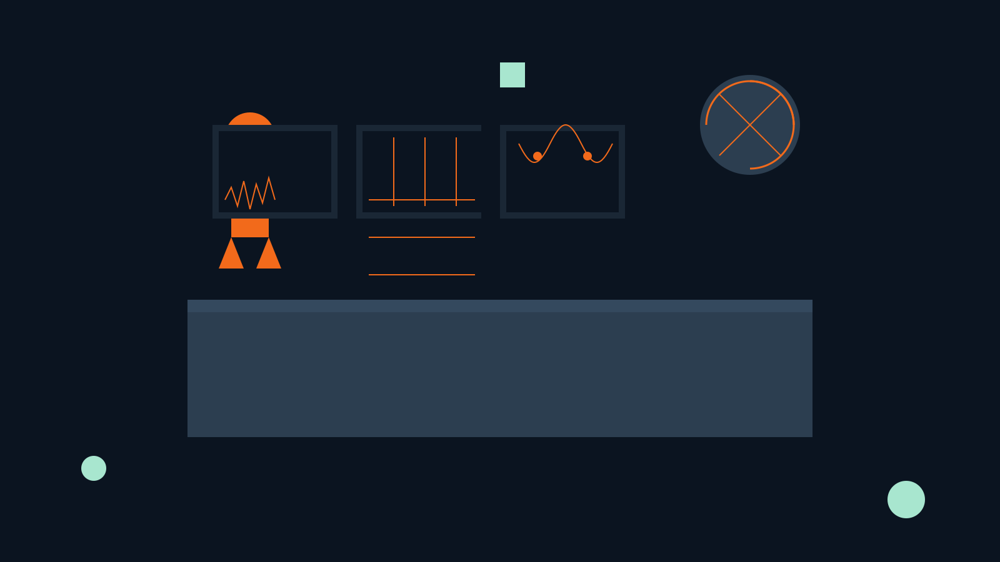

# Как построить эффективную программу комплаенса в условиях новых требований FATF

В условиях усиливающегося международного давления со стороны Financial Action Task Force (FATF) руководители отделов комплаенса, внутреннего контроля и бизнес‑лидеры сталкиваются с необходимостью быстро адаптировать свои процессы к постоянно меняющимся стандартам по борьбе с отмыванием денег и финансированием терроризма. В статье мы разберём, какие практические шаги помогут построить надёжную систему комплаенса, как правильно оценить риски и какие инструменты использовать для контроля соответствия в 2026 году.

## 1. Понимание текущего регуляторного поля FATF

FATF — международная межправительственная организация, созданная в 1989 году группой G‑7 с целью координации глобальной борьбы с отмыванием денег (AML) и финансированием терроризма (CFT). По данным официального сайта FATF, организация разрабатывает рекомендации, проводит взаимные оценки (mutual evaluations) и публикует списки «высокорисковых» юрисдикций, где наблюдаются серьёзные пробелы в системе противодействия финансовым преступлениям.

В 2026 году в FATF насчитывается 37 полноправных членов и более 170 стран‑участников, включая региональные органы. Список членов отражён на портале World Population Review, где указано, что Россия в данный момент находится в статусе «Suspended» (приостановленное членство). Это означает, что российские финансовые институты находятся под повышенным контролем со стороны международных партнёров и могут столкнуться с ограничениями доступа к глобальным финансовым рынкам.

Для компаний, работающих в России или с российскими контрагентами, это создаёт двойную нагрузку: необходимо соблюдать как национальные требования (например, закон «О противодействии отмыванию доходов, полученных преступным путём»), так и международные стандарты FATF, которые могут быть более строгими. Игнорирование этих требований чревато не только штрафами, но и репутационными потерями, а также ограничением возможности вести трансграничные расчёты.

## 2. Оценка рисков: от отраслевого к клиентскому профилю

Первый практический шаг — построение системной модели оценки рисков, которая учитывает три уровня: отраслевой, географический и клиентский.

* **Отраслевой риск**. FATF в своих рекомендациях выделяет «сектора повышенного риска», такие как банковская деятельность, нефть и газ, драгоценные металлы, а также криптовалютные сервисы. Если ваша компания работает в одном из этих секторов, базовый уровень контроля должен быть повышен: более частые проверки транзакций, обязательный мониторинг политически значимых лиц (PEP) и расширенный KYC‑процесс.

* **Географический риск**. Список стран‑участников FATF позволяет быстро определить, какие юрисдикции находятся в категории «high‑risk jurisdictions». На 2026 год в этом списке присутствуют, например, Иран, Северная Корея и ряд стран с приостановленным членством. При работе с контрагентами из этих регионов необходимо проводить усиленную проверку источников средств и цели операций.

* **Клиентский профиль**. На практике рекомендуется использовать многокритериальную матрицу, где каждому клиенту присваивается балл по таким параметрам, как объём и частота транзакций, структура собственности, наличие PEP, география деятельности. Баллы выше установленного порога автоматически переводят клиента в категорию «высокий риск», требующую ручного одобрения и более частого пересмотра.

Для реализации такой модели полезно задействовать специализированные решения по управлению рисками (Risk‑Based Approach, RBA), которые позволяют автоматически обновлять профили клиентов в реальном времени, используя данные из открытых источников и внутренних систем. При этом важно обеспечить соответствие выбранного инструмента требованиям GDPR и российского закона о персональных данных.

## 3. Технологический арсенал комплаенса в 2026 году

Современный комплаенс невозможен без автоматизации. Ниже перечислены ключевые технологические компоненты, которые должны стать частью любой программы AML/CFT.

1. **Системы мониторинга транзакций (Transaction Monitoring Systems, TMS)**. Современные TMS используют машинное обучение для выявления аномальных паттернов. При интеграции с банковскими API они способны в режиме реального времени сравнивать текущие операции с историческими данными и выдавать алерты с указанием уровня вероятности риска.

2. **Платформы управления клиентскими данными (Customer Due Diligence, CDD)**. Такие решения позволяют централизованно хранить документы KYC, проводить автоматическую проверку санкционных списков (OFAC, EU, UN) и обновлять данные о PEP. Интеграция с сервисами глобального мониторинга (World-Check, Dow Jones) сокращает время проверки новых контрагентов с нескольких дней до нескольких часов.

3. **Технологии аналитики открытых данных (OSINT)**. Несмотря на ограничения, связанные с проверкой достоверности, OSINT‑инструменты позволяют быстро собрать информацию о юридических лицах, их владельцах и связях. Важно сочетать их с внутренними проверками, чтобы избежать ложных срабатываний.

4. **Блокчейн‑решения для трассировки финансовых потоков**. Некоторые крупные банки уже используют распределённый реестр для записи ключевых этапов трансакций, что повышает прозрачность и упрощает последующий аудит.

При выборе технологического стека необходимо учитывать совместимость с существующей ИТ‑инфраструктурой, а также наличие локальной поддержки и соответствие требованиям к защите информации.

## 4. Организационные меры и культура комплаенса

Технологии работают только в том случае, если за ними стоит правильно построенная организационная модель. Ниже – практические рекомендации, проверенные в крупных международных корпорациях.

* **Назначение главного комплаенс‑офицера (Chief Compliance Officer, CCO)**. CCO должен иметь прямой доступ к совету директоров и независимый бюджет. Это гарантирует, что вопросы комплаенса рассматриваются на стратегическом уровне, а не как вспомогательная функция.

* **Создание мультидисциплинарных комитетов**. Включите в состав представителей юридического отдела, финансов, ИТ‑безопасности и бизнес‑подразделений. Регулярные встречи (не реже квартала) позволяют быстро реагировать на изменения в регуляторных требованиях и обмениваться лучшими практиками.

* **Обучение персонала**. По данным FATF, одна из главных причин неэффективного AML‑контроля – недостаточная осведомлённость сотрудников. Разработайте программу обязательного обучения с элементами интерактивных кейсов, тестов и ежегодного повторного сертифицирования.

* **Внутренний аудит и тестирование**. Проводите независимый аудит комплаенс‑процессов минимум два раза в год. При обнаружении пробелов внедряйте корректирующие действия в течение 30 дней и фиксируйте их в системе управления инцидентами.

* **Культура «своевременного сообщения»**. Поощряйте сотрудников сообщать о подозрительных операциях без страха репрессий. Внедрите анонимные каналы связи и гарантируйте защиту от увольнения за добросовестное сообщение.

Эти меры помогают не только соответствовать требованиям FATF, но и формируют устойчивую репутацию компании в глазах инвесторов и партнёров.

## 5. Как подготовиться к взаимной оценке FATF

Взаимные оценки (mutual evaluations) – основной механизм контроля за выполнением рекомендаций FATF. Прохождение такой оценки может стать критическим моментом для компаний, работающих в «высокорисковых» юрисдикциях.

1. **Сбор доказательной базы**. Подготовьте полный пакет документов, включающий политику AML/CFT, результаты последних аудитов, отчёты о проведённых обучениях, список использованных технологических решений и их параметры.

2. **Проверка соответствия рекомендациям FATF 40‑Пунктов**. Особое внимание уделите пунктам 10 (Customer Due Diligence), 11 (Enhanced Due Diligence) и 20 (International Cooperation). Для каждого пункта необходимо продемонстрировать, как ваша организация реализует требуемые процедуры.

3. **Тестирование сценариев**. Проведите внутренние стресс‑тесты, моделируя попытки отмывания средств через сложные цепочки транзакций. Оцените, насколько быстро система обнаруживает аномалии и какие действия предпринимаются.

4. **Взаимодействие с регуляторами**. Установите постоянный диалог с национальными надзорными органами (например, Росфинмониторинг). Их рекомендации часто учитываются при формировании международных оценок.

5. **План пост‑оценочного улучшения**. После получения отчёта о взаимной оценке составьте дорожную карту с конкретными сроками и ответственными лицами. Это покажет международному сообществу вашу готовность к постоянному совершенствованию.

Следуя этим рекомендациям, компании смогут не только успешно пройти оценку, но и укрепить свои внутренние процессы, что в долгосрочной перспективе снизит операционные риски и повысит конкурентоспособность.

## 6. Выводы для руководителей

* **Системный подход**. Оценка рисков, технологическая автоматизация и организационные меры должны работать в единой экосистеме. Разделение ответственности без интеграции приводит к «дырам» в защите.
* **Адаптация к изменениям FATF**. Поскольку список «высокорисковых» стран и рекомендаций обновляется регулярно, необходимо внедрять процесс постоянного мониторинга нормативных изменений.
* **Инвестиции в технологии и обучение**. Первоначальные затраты на современные TMS и CDD‑платформы окупаются за счёт снижения количества штрафов и ускорения клиентского онбординга.
* **Прозрачность и диалог**. Открытое взаимодействие с регуляторами и внутренний аудит повышают доверие инвесторов и партнёров, что особенно важно в условиях приостановленного членства России в FATF.

Эти принципы помогут руководителям комплаенса построить надёжную, гибкую и эффективную программу, отвечающую как национальным, так и международным требованиям в 2026 году.

## Источники
- [Financial Action Task Force](https://www.fatf-gafi.org/)
- [Financial Action Task Force - Wikipedia](https://en.wikipedia.org/wiki/Financial_Action_Task_Force)
- [Financial Action Task Force | U.S. Department of the Treasury](https://home.treasury.gov/policy-issues/terrorism-and-illicit-finance/financial-action-task-force)
- [FATF (Financial Action Task Force) Countries 2026](https://worldpopulationreview.com/country-rankings/fatf-countries)
- [Microsoft Corporation (MSFT) Stock Price, News, Quote & History - Yahoo ...](https://finance.yahoo.com/quote/MSFT/)
- [Акции Microsoft Corporation | MSFT - Цена сегодня](https://marketcap.ru/stocks/MSFT)
- [$489,527 | Microsoft Corporation Common Stock (MSFT ... - Binance](https://www.binance.com/ru/stocks/EQ_MSFT)
- [MSFT News Today | Why did Microsoft stock go down today?](https://www.marketbeat.com/stocks/NASDAQ/MSFT/news/)
