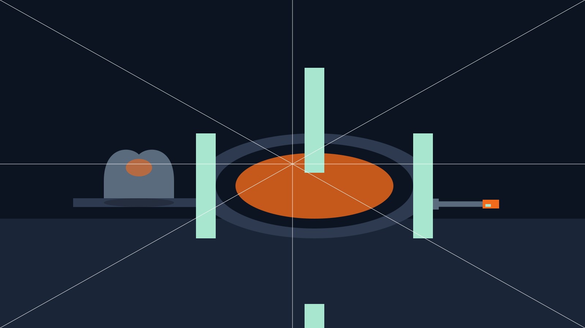

# Российские технологические прорывы: новые тренажёры, глушители и 20‑летний юбилей ИТЭР

Технологический ландшафт России в конце 2026 года демонстрирует рост активности в самых разных отраслях: от подготовки космонавтов до модернизации вооружения и участия в международных энергетических проектах. За последние сутки официальные источники сообщили о запуске нового наземного тренажёра «Выход‑2» в Центре подготовки космонавтов (ЦПК), о внедрении газоразгруженного глушителя в компактных винтовках СВЧ‑1/СВЧ‑2 Концерна «Ростех», а также отметили двадцатилетний юбилей международного термоядерного экспериментального реактора (ИТЭР). Ниже — подробный разбор каждой инициативы, её текущего статуса и потенциального влияния на соответствующие отрасли.

## Тренажёр «Выход‑2»: имитация невесомости в гидролаборатории ЦПК

На этой неделе космонавт Роскосмоса Арутюн Кивирян прошёл цикл тренировок на наземном тренажёре «Выход‑2», который установлен в Центре подготовки космонавтов (ЦПК) в г. Звёздный (Москва). По материалам официального телеграм‑канала Роскосмоса, комплекс представляет собой совокупность нескольких подсистем, позволяющих воспроизводить условия выхода в открытый космос без выхода в реальную орбиту.

Ключевые элементы «Выход‑2» включают два тренировочных скафандра «Орлан‑МКС», устройство обезвешивания, позволяющее космонавтам перемещаться в рабочей зоне при минимальном усилии, а также макеты шлюзовых отсеков, которые имитируют реальные конструкции МКС. Встроенная вычислительная система управляет моделированием светотеневой обстановки, системой связи, телевизионного и медицинского контроля. Перед началом тренировок астронавты проходят медосмотр, надевают медицинское оборудование и нательное бельё, после чего одеваются в два специальных элемента: синий костюм водяного охлаждения и скафандр «Орлан‑МКС».

Тренажёр позволяет отрабатывать процедуры выхода в открытый космос, работу с инструментами и манипуляцию в условиях микрогравитации, что особенно актуально в преддверии будущих миссий к Луне и Марсу. По словам руководителей ЦПК, «Выход‑2» находится в стадии пилотного внедрения: после серии тренировок с опытными космонавтами планируется расширить программу и включить в неё подготовку новых членов экипажа, а также иностранных партнёров в рамках международных проектов. На данный момент система уже прошла внутреннюю верификацию и готова к эксплуатации в полном масштабе, однако её массовое использование в других центрах подготовки России пока не анонсировано.

## Газоразгруженный глушитель для СВЧ‑1/СВЧ‑2: решение проблемы загазованности

Концерн «Ростех», совместно с дочерним предприятием «Калашников», представил новый газоразгруженный глушитель, предназначенный для компактных винтовок СВЧ‑1 и СВЧ‑2. По данным официального сообщения в телеграм‑канале «Ростех», глушитель разработан в ответ на запрос эксплуатантов, которым требуется лёгкое, манёвренное оружие для городского боя, но при этом необходимо минимизировать негативные эффекты от вдыхания пороховых газов.

СВЧ‑1 и СВЧ‑2 — это укороченные версии знаменитой снайперской винтовки Чукавина (СВЧ). Длина ствола уменьшена на 170 мм, что привело к общей длине 450 мм, сохранив при этом эффективность стрельбы до 800 м. Укороченный ствол усиливает проблему загазованности: при выстреле часть пороховых газов возвращается в помещение через дульное устройство, вызывая дискомфорт, усталость глаз и снижение концентрации у стрелка.

Новый глушитель решает эту задачу, перенаправляя часть газов в специальный канал, где они охлаждаются и частично фильтруются перед выходом наружу. По заявлению разработчиков, это позволяет сократить концентрацию вредных веществ в зоне стрельбы почти на 70 % без существенного снижения акустической эффективности глушителя. Технология уже прошла испытания в лабораторных условиях и получила положительные отзывы от представителей штурмовых подразделений, участвовавших в полевых тестах.

Сейчас глушитель находится в стадии серийного внедрения: первые партии поставляются в подразделения быстрого реагирования Министерства обороны РФ. Ожидается, что в ближайшие полугода глушитель будет установлен на все новые партии СВЧ‑1/СВЧ‑2, а также будет доступен для модернизации уже находящихся в арсенале образцов. Массовое производство планируется в заводах «Калашникова», однако точные сроки поставок за пределами РФ пока не объявлены.

## ИТЭР отмечает 20‑летний юбилей: роль России в международном термоядерном проекте

21 ноября 2026 года в соцсетях «Росатома» был опубликован материал, посвящённый двадцатилетию со дня подписания соглашения о создании Международного термоядерного экспериментального реактора (ИТЭР). Проект, инициированный в 2006 году группой стран (ЕС, Китай, Индия, Япония, Республика Корея, Россия и США), направлен на демонстрацию технологической осуществимости термоядерной энергетики и развитие безопасных, низкоуглеродных источников энергии.

Российские специалисты отвечают за более чем 25 систем установки, включая системы магнитного удержания плазмы, охлаждения и диагностики. В их числе — разработки в области сверхпроводящих магнитов, систем управления током и радиационной защиты. По информации «Росатома», в проекте задействовано более 50 научных организаций и промышленных предприятий России, что делает страну одним из ключевых технологических партнёров.

На текущий момент ИТЭР находится в фазе «передачи энергии в сеть» (англ. “Q‑phase”), когда планируется впервые вывести в сеть электрическую мощность, полученную в результате термоядерных реакций. Этот этап считается критическим, поскольку подтверждает возможность коммерческого использования термоядерной энергии. Россия продолжает поставлять комплектующие и участвует в интеграции систем, однако окончательная оценка готовности к коммерческому запуску будет сделана только после завершения всех испытаний, запланированных на 2027 год.

Юбилей подчёркивает долговременную приверженность России к международному научному сотрудничеству в сфере энергетики. Несмотря на геополитические ограничения, участие в ИТЭР остаётся одним из самых масштабных примеров совместных исследований, где российские разработки в области сверхпроводимости и плазменной диагностики играют ключевую роль.

## Перспективы и выводы: от наземных симуляций к глобальной энергетике

Три события, озвученные за последние 36 часов, иллюстрируют разнообразие технологических направлений, в которых Россия сохраняет активную позицию. Тренажёр «Выход‑2» демонстрирует рост возможностей отечественной космической инфраструктуры, позволяя готовить космонавтов к сложным задачам в условиях микрогравитации без необходимости дорогостоящих полётов на орбиту. Газоразгруженный глушитель для СВЧ‑1/СВЧ‑2 решает практическую проблему, повышая боеспособность и безопасность стрелков в условиях городской войны, что свидетельствует о тесной связи между научными исследованиями и оперативными потребностями вооружённых сил. Наконец, участие России в ИТЭР подтверждает её роль в глобальном научном сообществе и в долгосрочной стратегии перехода к низкоуглеродной энергетике.

Все три проекта находятся на разных стадиях жизненного цикла: «Выход‑2» — пилотный запуск с планами расширения, глушитель — серийное внедрение в вооружённые формирования, а ИТЭР — крупномасштабный международный эксперимент, приближающийся к фазе коммерческого тестирования. Их совместное развитие создаёт синергетический эффект: технологии, отработанные в космических и оборонных системах, могут быть перенесены в энергетический сектор, а международные научные коллаборации укрепляют научный потенциал страны.

Таким образом, текущие новости подтверждают, что российская технологическая экосистема продолжает эволюцию, сочетая практические решения для национальной безопасности с участием в глобальных научных проектах, направленных на решение задач будущего.

## Источники
- [👨‍🚀 Как в ЦПК имитируют условия невесомости для обучения космонавтов — смотрите короткий ролик о гидролаборатории и тренажёре «Выход-2»\n\nНа этой неделе космонавт Роскосмоса Арутю](https://t.me/roscosmos_gk/21098)
- [🪖 Новые СВЧ Ростеха впервые получили газоразгруженный глушитель для защиты стрелка.\n\nНаш Концерн «Калашников» применил в компактных винтовках СВЧ-1 и СВЧ-2 газоразгруженный глуши](https://t.me/rostecru/13129)
- [ИТЭР: 20 лет технологического совершенства\n \nВ 2006 году Европейский союз, Китай, Индия, Япония, Республика Корея, Россия и США объединили усилия для реализации крупнейшего научн](https://t.me/rosatomru/7541)
