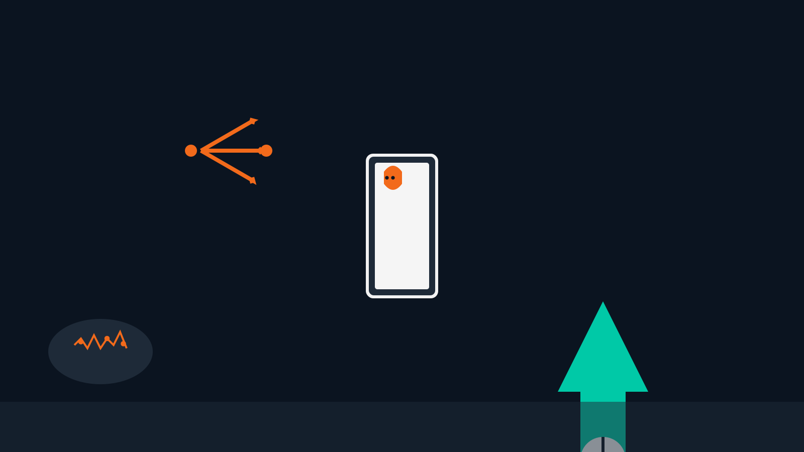

# Как работают современные схемы финансового мошенничества: механика, индикаторы и пределы детектирования

Мошенничество в финансовом секторе постоянно эволюционирует, подстраиваясь под новые технологии и регулятивные инициативы. В 2026 году аналитики отмечают рост сложных схем, использующих как традиционные каналы (карты, банковские переводы), так и цифровые инструменты (криптовалюты, AI‑генерированные запросы). В статье рассматриваются типовые механизмы текущих схем, ключевые индикаторы их появления и ограничения, с которыми сталкиваются системы антифрода.

## 1. Механика популярных схем 2026 года

### 1.1. «Кредитные‑переадресации» через мобильные приложения
Злоумышленники получают доступ к аккаунтам клиентов через фишинговые сообщения, после чего инициируют серию небольших переадресаций (от $50 до $500) на «посреднические» карты. Такие операции часто проходят под порогом автоматических блокировок, а последующее объединение средств происходит в «мульти‑кассах» – сервисах, позволяющих мгновенно конвертировать деньги в электронные ваучеры.

### 1.2. «Торговля‑посредник» в e‑commerce
Схема подразумевает создание поддельных онлайн‑магазинов, которые принимают оплату картой, но товар никогда не отправляют. Вместо этого полученные средства переводятся в криптовалюту через миксеры, а затем выводятся на офшорные биржи. В 2026 году наблюдается рост использования AI‑генерированных описаний товаров, что усложняет распознавание подделок.

### 1.3. «Синтетический кредитный риск» в инвестиционных платформах
Некоторые платформы позволяют пользователям «создавать» кредитные линии, используя алгоритмические модели оценки риска. Мошенники подают фальшивые финансовые отчёты, получают одобрение и сразу же переводят средства в «пул» высокодоходных инвестиций, где они быстро «перемешиваются» с легальными вкладами.

### 1.4. «AI‑поддерживаемый спуфинг» в банковском обслуживании
С развитием больших языковых моделей (LLM) преступники способны генерировать правдоподобные запросы в службу поддержки, имитируя голос и стиль реального клиента. Такие запросы часто приводят к изменению лимитов, выдаче новых карт или переоформлению кредитов без участия клиента.

Эти схемы объединяют традиционные методы (социальная инженерия, подделка документов) и новейшие технологические возможности, что делает их особенно опасными для финансовых институтов.

## 2. Индикаторы, позволяющие выявлять мошенническую активность

### 2.1. Аномалии в паттернах транзакций
Системы антифрода используют статистический анализ частоты, суммы и географии операций. Внезапный рост небольших переводов в разные страны, особенно если они идут от новых или малоактивных клиентов, часто указывает на «кредитные‑переадресации».

### 2.2. Несоответствия в профиле устройства
AI‑поддерживаемый спуфинг часто оставляет следы: изменение IP‑адреса, использование эмуляторов мобильных ОС, отсутствие типичных «отпечатков» браузера. Современные решения сравнивают текущие данные с историей устройства, выделяя отклонения.

### 2.3. Необычные цепочки конвертации валют
При работе с криптовалютой важен мониторинг переходов через миксеры и быстрых обменников. Если в течение часа происходит несколько конвертаций из фиатных средств в анонимные токены, это сигнализирует о попытке отмывания.

### 2.4. Повторяющиеся шаблоны в коммуникации
Фишинговые кампании часто используют одинаковый набор фраз, ссылки и визуальные элементы. Машинное обучение позволяет классифицировать такие сообщения и блокировать их до того, как пользователь перейдёт по ссылке.

Эти индикаторы работают в совокупности: один сигнал может быть безвредным, но их комбинация повышает вероятность обнаружения.

## 3. Ограничения современных систем детектирования

### 3.1. Ограничения данных и конфиденциальность
Для построения точных моделей требуется большой объём исторических данных. Однако законы о защите персональных данных (например, российский закон о персональных данных) ограничивают сбор и хранение информации, что приводит к «разреженности» обучающих наборов.

### 3.2. Адаптивность злоумышленников
Схемы постоянно меняются. Как только система начинает фиксировать определённый паттерн, преступники модифицируют свои методы, используя, к примеру, более мелкие суммы или новые каналы (социальные сети, мессенджеры). Это создаёт «гонку вооружений», где антифрод‑модели отстают от реального поведения.

### 3.3. Ошибки классификации и бизнес‑риски
Слишком агрессивные правила могут привести к ложным срабатываниям, блокируя легальные операции и ухудшая клиентский опыт. С другой стороны, слишком «мягкие» настройки увеличивают пропускную способность мошенничества. Баланс между безопасностью и удобством остаётся открытой задачей.

### 3.4. Технические ограничения в реальном времени
Обработка больших потоков транзакций в режиме реального времени требует значительных вычислительных ресурсов. При пиковых нагрузках системы могут переключаться в «пакетный» режим, что задерживает реакцию на подозрительные операции.

Эти ограничения подчёркивают необходимость многослойного подхода: сочетание автоматических систем, ручного анализа и постоянного обновления правил.

## 4. Практические рекомендации для финансовых организаций

1. **Интеграция мульти‑канальных данных** – объединять информацию из банковских, мобильных, соцсетевых и криптовалютных источников, чтобы построить полную картину поведения клиента.

2. **Регулярный аудит моделей** – проводить пересмотр алгоритмов не реже чем раз в квартал, учитывая новые типы атак, описанные в отраслевых отчётах (например, расследования SEC, связанные с бухгалтерскими аномалиями в крупных технологических компаниях).

3. **Обучение персонала** – сотрудники фронт‑офиса должны знать о новых схемах, таких как AI‑поддерживаемый спуфинг, и уметь распознавать аномалии в запросах клиентов.

4. **Сотрудничество с внешними платформами** – обмен информацией о подозрительных IP‑адресах, миксерах и новых фишинговых доменах через отраслевые форумы и инициативы, поддерживаемые регуляторами.

5. **Тестирование «красных команд»** – привлекать независимых специалистов для имитации атак, что позволяет выявить слабые места в системе детектирования до того, как их обнаружат злоумышленники.

Эти меры позволяют не только повысить эффективность обнаружения, но и снизить количество ложных срабатываний, сохраняя доверие клиентов.

## 5. Выводы

Схемы финансового мошенничества в 2026 году становятся всё более гибкими, сочетая традиционные методы социальной инженерии с передовыми технологиями, такими как генеративный ИИ и криптовалютные миксеры. Ключевые индикаторы – аномалии в транзакциях, устройствах, валютных цепочках и коммуникациях – позволяют выявлять большинство атак, однако ограничения в данных, адаптивность злоумышленников и технические барьеры снижают эффективность чисто автоматических решений.

Для борьбы с этим вызовом финансовым организациям необходимо развивать многослойные стратегии, включающие интеграцию разнородных данных, постоянный аудит моделей, обучение персонала и активное сотрудничество с отраслевыми партнёрами. Только такой комплексный подход способен удержать темпы мошеннической эволюции под контролем и обеспечить надёжную защиту клиентов.

## Источники
- [Financial Partners Credit Union | Best CA Credit Union | Banking](https://fpcu.org/)
- [Yahoo Finance - Stock Market Live, Quotes, Business & Finance ...](https://finance.yahoo.com/)
- [Lobel Financial - Home](https://www.lobelfinancial.com/)
- [Как настроить второй монитор на Windows 10: 10 шагов](https://ru.wikihow.com/%D0%BD%D0%B0%D1%81%D1%82%D1%80%D0%BE%D0%B8%D1%82%D1%8C-%D0%B2%D1%82%D0%BE%D1%80%D0%BE%D0%B9-%D0%BC%D0%BE%D0%BD%D0%B8%D1%82%D0%BE%D1%80-%D0%BD%D0%B0-Windows-10)
- [Использование нескольких мониторов в Windows](https://support.microsoft.com/ru-ru/windows/hardware/display-graphics/how-to-use-multiple-monitors-in-windows)
- [Настройка двух или нескольких мониторов в Windows 11 и 10](https://remontka.pro/connect-two-monitors-computer/)
- [Windows 11/10 Как подключить один или несколько внешних мониторов](https://www.asus.com/ru/support/faq/1047026/)
- [Как настроить второй монитор в Windows 10](https://winnote.ru/instructions/401-kak-nastroit-vtoroy-monitor-v-windows-10.html)
