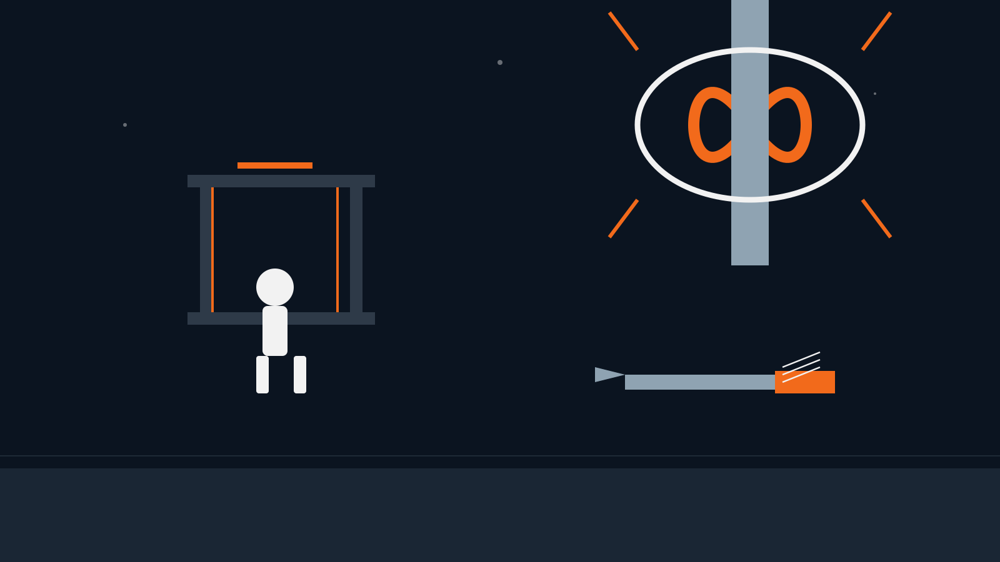

# Российские технологические инициативы: от имитации невесомости до новых решений в оружейных системах

В последние недели в России анонсированы несколько значимых технологических событий, охватывающих космическую подготовку, оборонные разработки и участие в международных научных проектах. Они демонстрируют, как отечественные организации переводят лабораторные исследования в практические прототипы и пилотные программы, а также сохраняют активную роль в глобальных инициативах. Ниже – подробный обзор новостей, опубликованных 21 ноября 2026 года, с указанием текущего статуса каждой разработки и её потенциального влияния на соответствующие отрасли.

## Имитация невесомости в Центре подготовки космонавтов

На этой неделе космонавт Роскосмоса Арутюн Кивирян прошёл цикл тренировок на новом наземном тренажёре «Выход‑2». Это комплекс, предназначенный для имитации условий выхода в открытый космос, объединяет несколько подсистем:

* два тренировочных скафандра «Орлан‑МКС»;
* устройство, обеспечивающее обезвешивание скафандров, позволяющее космонавтам перемещаться в рабочей зоне без применения силы тяжести;
* макеты шлюзовых отсеков, воспроизводящие геометрию реального модуля;
* вычислительная система, управляющая динамикой движения и реактивными реакциями;
* наземная система жизнеобеспечения, контролирующая параметры давления, температуры и состава атмосферы;
* система моделирования светотеневой обстановки, имитирующая солнечную и земную освещённость;
* системы связи, видеонаблюдения и медицинского контроля, позволяющие в реальном времени отслеживать состояние экипажа.

Перед началом тренировок космонавты проходят медицинский осмотр, надевают специальное медицинское оборудование и нательное бельё, а затем два элемента защитного костюма – синий костюм водяного охлаждения и скафандр «Орлан‑МКС». После этого они приступают к работе в гидролаборатории, где имитируется микрогравитация за счёт погружения в воду, а затем переходят к сухой тренировке на «Выход‑2», где управляют движением с помощью системы обезвешивания.

Тренажёр находится в стадии **пилотного внедрения**: уже проведено несколько полных циклов с участием опытных космонавтов, однако окончательная сертификация и подготовка к массовому использованию в подготовке будущих экипажей планируется к 2027 году. По словам представителей Центра подготовки, такой подход позволяет сократить время адаптации к работе в открытом космосе и снизить расходы на орбитальные испытания.

## Газоразгруженный глушитель для короткоствольных винтовок СВЧ

Концерн «Калашников», совместно с Ростехом, представил **прототип газоразгруженного глушителя**, адаптированный для компактных винтовок семейства СВЧ‑1 и СВЧ‑2. Эти модели, основанные на снайперской винтовке Чукавина (СВЧ), были укорачены на 170 мм до общей длины 450 мм, чтобы соответствовать требованиям штурмовых подразделений и групп быстрого реагирования в условиях городского боя.

Сокращённый ствол, хотя и сохраняет точность до 800 м, усиливает проблему загазованности: при выстреле пороховые газы в закрытом пространстве могут возвращаться к стрелку, вызывая дискомфорт, утомление глаз и снижение концентрации. Новый глушитель решает эту задачу, **перенаправляя и фильтруя** отработанные газы, что уменьшает их концентрацию в зоне выстрела и повышает безопасность оператора.

Технология находится в **этапе испытаний**: первые образцы переданы в эксплуатирующие подразделения для полевых тестов, результаты которых будут собраны к концу 2026 года. По заявлению разработчиков, глушитель сохраняет акустические характеристики, позволяя снизить уровень шума до 115 дБ без значительного ухудшения баллистических параметров. Если испытания подтвердят заявленные показатели, планируется серийное производство в 2027 году с последующим внедрением в арсеналы подразделений быстрого реагирования.

## 20‑летний юбилей проекта ITER: роль России в международной термоядерной инициативе

21 ноября отмечается **20‑летие подписания Соглашения о создании Международного термоядерного экспериментального реактора (ITER)**. Проект, инициированный в 2006 году группой стран (ЕС, Китай, Индия, Япония, Республика Корея, Россия и США), направлен на демонстрацию технологической осуществимости термоядерной энергии как практически неисчерпаемого и низкоуглеродного источника энергии.

Российские специалисты отвечают за **25 систем установки**, включая ключевые подсистемы плазменного нагрева, магнитного удержания и систем диагностики. В реализации проекта задействовано более 50 российских научных организаций и промышленных предприятий, что обеспечивает широкое технологическое присутствие России в глобальном научно‑техническом сотрудничестве.

На текущий момент ITER находится в **пилотной фазе строительства**: основные магнитные системы уже собраны, а работа по интеграции термоядерного реактора продолжается. Ожидается, что первая плазма будет запущена в 2027‑2028 гг., после чего начнётся серия экспериментальных кампаний, направленных на достижение «запуска» (Q ≥ 10) к 2035 году. Участие России в этом проекте позволяет перенести полученные ноу‑хау в национальные программы по развитию термоядерной энергетики и укрепить научно‑техническую базу страны.

## Перспективы интеграции новых технологий в гражданские и оборонные сектора

Сочетание описанных выше инициатив иллюстрирует общую стратегию России: **перевод лабораторных исследований в практические прототипы**, их **пилотное тестирование** и последующее **массовое внедрение**. Тренажёр «Выход‑2» повышает эффективность подготовки космонавтов, сокращая зависимость от дорогостоящих орбитальных миссий. Газоразгруженный глушитель решает конкретную проблему боевой эксплуатации компактного оружия, улучшая условия работы стрелков в закрытых помещениях. Участие в ITER поддерживает технологический суверенитет в области энергетики и обеспечивает доступ к передовым решениям в области плазменных технологий.

Все три проекта находятся на разных стадиях жизненного цикла, но объединены общим принципом: **многократные испытания и обратная связь от конечных пользователей** перед переходом к серийному производству. Такой подход снижает риски технологических сбоев и повышает шансы успешного внедрения в реальную эксплуатацию.

## Итоги и дальнейшие шаги

* Тренажёр «Выход‑2» уже прошёл несколько полных тренировочных циклов; окончательная сертификация запланирована на 2027 год.
* Газоразгруженный глушитель проходит полевые испытания в штурмовых подразделениях; серийное производство ожидается в 2027 году при положительных результатах.
* Россия продолжает активное участие в ITER, где к 2027‑2028 годам планируется первая плазма, а к 2035 году – достижение энергетического выхода Q ≥ 10.

Эти события подтверждают, что российские научные и производственные организации способны создавать и внедрять передовые технологии в самых разных областях – от космических тренировок до оборонных систем и международных энергетических проектов. Их дальнейшее развитие будет зависеть от успешного завершения текущих испытаний и от уровня поддержки со стороны государства и частных инвесторов.

## Источники
- [👨‍🚀 Как в ЦПК имитируют условия невесомости для обучения космонавтов — смотрите короткий ролик о гидролаборатории и тренажёре «Выход-2»\n\nНа этой неделе космонавт Роскосмоса Арутю](https://t.me/roscosmos_gk/21098)
- [🪖 Новые СВЧ Ростеха впервые получили газоразгруженный глушитель для защиты стрелка.\n\nНаш Концерн «Калашников» применил в компактных винтовках СВЧ-1 и СВЧ-2 газоразгруженный глуши](https://t.me/rostecru/13129)
- [ИТЭР: 20 лет технологического совершенства\n \nВ 2006 году Европейский союз, Китай, Индия, Япония, Республика Корея, Россия и США объединили усилия для реализации крупнейшего научн](https://t.me/rosatomru/7541)
