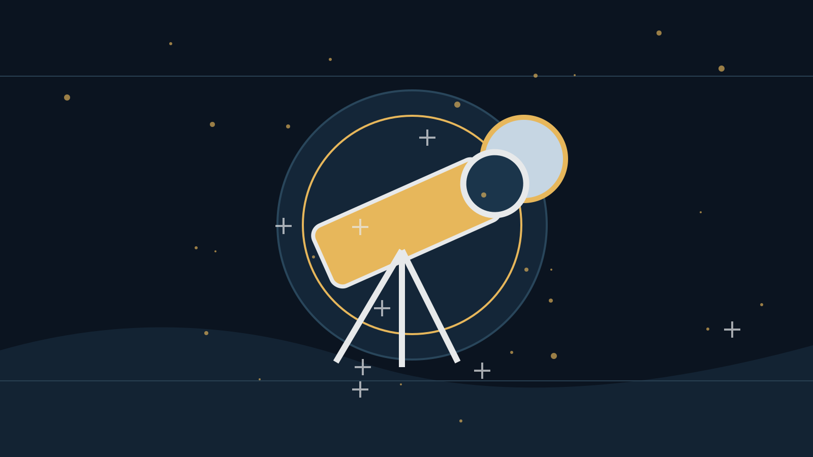

# Российские технологические новости 21 ноября 2026 г.: космический тренажёр, газоразгруженный глушитель и 20‑летний юбилей ИТЭР

Космические испытания, новые решения в стрелковом оборудовании и отметка двух десятилетий международного термоядерного проекта — все эти события произошли в один день, показывая разнообразие и динамику технологических инициатив России.

## Тренажёр «Выход‑2»: имитация невесомости в наземных условиях

На этой неделе космонавт Роскосмоса Арутюн Кивирян завершил цикл тренировок на наземном тренажёре «Выход‑2», который предназначен для отработки выходов в открытый космос без необходимости полётов в реальную орбиту. Тренажёр располагается в Центре подготовки космонавтов (ЦПК) и представляет собой комплекс из нескольких подсистем:

* два тренировочных скафандра «Орлан‑МКС», полностью воспроизводящих внешний вид и функциональность орбитальных скафандров;
* устройство, обеспечивающее обезвешивание скафандров, позволяющее космонавтам перемещаться в рабочей зоне, используя только собственные силы;
* макеты шлюзовых отсеков, имитирующие переходные зоны между кораблём и открытым космосом;
* вычислительная система, управляющая моделированием физики и синхронизацией действий;
* наземная система жизнеобеспечения, поддерживающая параметры давления, температуры и состава воздуха;
* система моделирования светотеневой обстановки, воспроизводящая солнечную и земную освещённость;
* системы связи, видеоконтроля и медицинского мониторинга, позволяющие в реальном времени отслеживать состояние космонавта.

Перед началом тренировок Кивирян прошёл обязательный медицинский осмотр, надел медицинское оборудование и специальное нательное бельё, а затем два элемента гидросистемы, обеспечивающие охлаждение и поддержку жизненно‑важных функций. После этого он надел «синий» костюм водяного охлаждения, который соединяется с системой обезвешивания.

Тренажёр «Выход‑2» находится в стадии эксплуатации: после нескольких лет испытаний он уже используется в регулярных тренировочных циклах, однако масштабное внедрение в подготовку всех будущих экипажей пока планируется в рамках постепенного расширения программы. По словам представителей ЦПК, такой наземный подход позволяет сократить количество дорогостоящих орбитальных миссий, сохраняя при этом высокий уровень подготовки персонала к реальным выходам в открытый космос.

## Газоразгруженный глушитель для компактных винтовок СВЧ‑1 и СВЧ‑2

Концерн «Калашников», входящий в состав Ростеха, представил новую модификацию глушителя, предназначенную для компактных снайперских винтовок серии СВЧ‑1 и СВЧ‑2. Данные образцы являются усовершенствованными вариантами известной снайперской винтовки Чукавина (СВЧ), адаптированными под требования современных штурмовых подразделений и групп быстрого реагирования.

Ключевые технические изменения:

* Укороченный ствол на 170 мм (до 450 мм), что повышает манёвренность в условиях городской застройки;
* Сохранённый уровень кучности стрельбы до 800 м, подтверждённый полевыми испытаниями;
* Интегрированный газоразгруженный глушитель, перенаправляющий часть пороховых газов от дульного отверстия в сторону, тем самым снижающий концентрацию вредных продуктов сгорания вблизи стрелка.

Проблема «загазованности», характерная для короткоствольного оружия, особенно в закрытых помещениях, решается за счёт специального канального устройства внутри глушителя, которое отводит газовый поток в сторону, а не назад к стрелку. По заявлению разработчиков, это снижает риск раздражения дыхательных путей, утомляемости глаз и потери концентрации у бойцов, что критически важно в длительных боевых столкновениях.

Технология уже прошла серию лабораторных и полевых испытаний, после чего была передана в опытные подразделения вооружённых сил для пилотного внедрения. На данный момент глушитель считается прототипом, готовым к масштабному производству, однако окончательное решение о серийном выпуске будет зависеть от результатов дальнейших полевых тестов и обратной связи от конечных пользователей.

## 20‑летний юбилей проекта ИТЭР: роль России в международной термоядерной инициативе

21 ноября отмечается двадцатая годовщина подписания соглашения о создании Международного термоядерного экспериментального реактора (ИТЭР). Проект, инициированный в 2006 году совместными усилиями Европейского союза, Китая, Индии, Японии, Республики Корея, России и США, направлен на демонстрацию технологической осуществимости термоядерной энергии как практически неисчерпаемого и низкоуглеродного источника электроэнергии.

Российские специалисты участвуют в реализации более 25 систем установки, охватывающих такие направления, как:

* магнитные системы управления плазмой;
* системы охлаждения и отвода тепла;
* диагностика и контроль параметров плазмы;
* системы безопасности и аварийного реагирования;
* программное обеспечение для моделирования термоядерных реакций.

В общей сложности в проекте задействовано более 50 научных организаций и промышленных предприятий России, включая Институт проблем управления РАН, НИИ «Курчатовский институт» и крупные производственные предприятия, поставляющие компоненты высокого технологического уровня.

На сегодняшний день ИТЭР находится в фазе «передача энергии в сеть», что предполагает построение экспериментального прототипа, способного генерировать более 500 мегаватт тепла. Российские поставки в рамках этой фазы включают комплект магнитных катушек, разработанных с использованием отечественных сверхпроводящих материалов, а также программные модули для управления плазмой, интегрированные в общую систему управления реактором.

Отметим, что несмотря на значительный прогресс, проект всё ещё находится в экспериментальной стадии: коммерческое использование термоядерной энергии планируется только после завершения всех испытаний, которые, согласно текущему графику, могут продлиться до середины 2030‑х годов. Тем не менее, участие России в ИТЭР подтверждает её статус одного из ключевых игроков в глобальном научно‑техническом сотрудничестве по развитию чистой энергии.

## Перспективы и взаимосвязи: от наземных тренировок к глобальному энергетическому будущему

События 21 ноября демонстрируют, как российские технологические инициативы охватывают широкий спектр отраслей. Тренажёр «Выход‑2» позволяет сократить затраты на подготовку космонавтов, одновременно повышая безопасность и эффективность обучения. Газоразгруженный глушитель решает практическую проблему, связанную с использованием короткоствольного оружия в условиях ограниченного пространства, что повышает боеспособность современных подразделений. А участие в ИТЭР укрепляет позиции России в международных проектах, направленных на решение глобальных энергетических задач.

Все три проекта находятся на разных стадиях жизненного цикла: «Выход‑2» уже эксплуатируется в учебных целях, глушитель находится в пилотной фазе, а ИТЭР — в предфинальной экспериментальной фазе. Такое разнообразие показывает, что российская научно‑техническая политика ориентирована как на быстрые внедрения (оружейные решения), так и на долгосрочные стратегические проекты (термоядерная энергия), а также на поддержание конкурентоспособности в космической сфере.

В совокупности эти инициативы формируют технологический фундамент, который может стать основой для дальнейшего развития отечественной промышленности, повышения национальной безопасности и участия в решении глобальных проблем, таких как изменение климата и энергетическая независимость.

## Источники
- [👨‍🚀 Как в ЦПК имитируют условия невесомости для обучения космонавтов — смотрите короткий ролик о гидролаборатории и тренажёре «Выход-2»\n\nНа этой неделе космонавт Роскосмоса Арутю](https://t.me/roscosmos_gk/21098)
- [🪖 Новые СВЧ Ростеха впервые получили газоразгруженный глушитель для защиты стрелка.\n\nНаш Концерн «Калашников» применил в компактных винтовках СВЧ-1 и СВЧ-2 газоразгруженный глуши](https://t.me/rostecru/13129)
- [ИТЭР: 20 лет технологического совершенства\n \nВ 2006 году Европейский союз, Китай, Индия, Япония, Республика Корея, Россия и США объединили усилия для реализации крупнейшего научн](https://t.me/rosatomru/7541)
