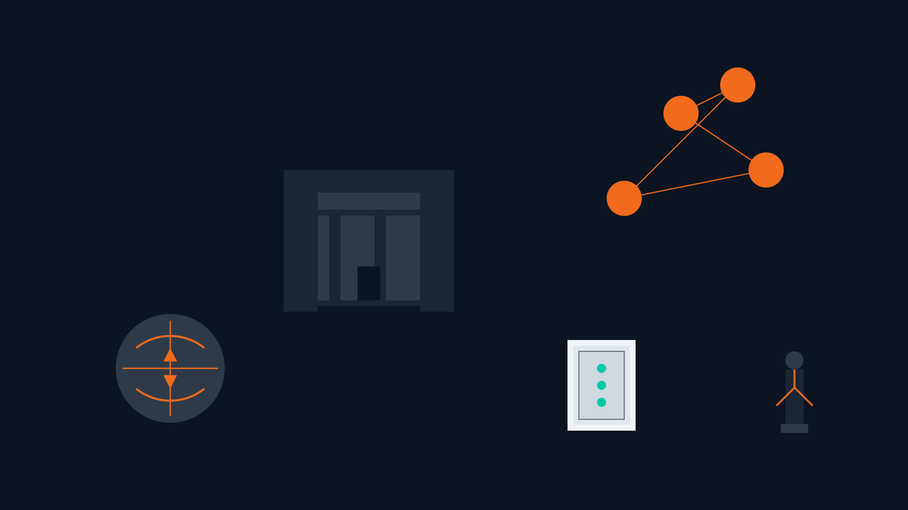

# Как новые рекомендации FATF 2024 меняют подход к управлению финансовыми рисками в банковском секторе

Международные стандарты по борьбе с отмыванием денег и финансированием терроризма постоянно эволюционируют. В 2024 году FATF представила обновлённый набор рекомендаций, ориентированных на цифровые активы, трансграничные платежи и усиленный контроль над высокорисковыми секторами. Банки, работающие в глобальном пространстве, вынуждены пересмотреть свои модели оценки риска, внедрить новые технологические решения и адаптировать внутренние процедуры под изменившиеся требования. Ниже — практический обзор ключевых нововведений и рекомендации по их оперативному внедрению.

## 1. Основные изменения в рекомендациях FATF 2024

* **Расширение понятия «высокорисковые юрисдикции»** – в список добавлены несколько стран с развивающимися цифровыми валютными рынками, что повышает требования к проверке клиентов из этих регионов.
* **Требования к виртуальным активам (VA)** – FATF ввела обязательный «полный цикл» контроля за криптовалютными операциями, включая идентификацию конечных бенефициаров и мониторинг смарт‑контрактов.
* **Усиленный контроль над трансграничными платежами** – обязательна проверка источника средств при переводах свыше 10 000 USD и автоматическое сопоставление с международными санкционными списками.
* **Обязательная отчетность о «слабых сигналах»** – помимо традиционных SAR банки должны подавать «Suspicious Indicator Reports» (SIR) при обнаружении подозрительных паттернов, даже если они не достигают порога для SAR.

Эти изменения направлены на закрытие пробелов, выявленных в последних глобальных оценках FATF, и требуют от банков пересмотра как политик, так и технологической инфраструктуры.

## 2. Пересмотр модели оценки риска (Risk‑Based Approach)

### 2.1 Перераспределение рисков по клиентским сегментам

* **Клиенты из новых высокорисковых юрисдикций** – переход к «enhanced due diligence» (EDD) уже на этапе onboarding.
* **Пользователи виртуальных активов** – обязательный анализ цепочки транзакций, включая проверку адресов в блокчейне через специализированные сервисы.
* **Трансграничные корпоративные клиенты** – внедрение двойного уровня контроля: предварительная оценка риска по стране и отдельный анализ по типу операции.

### 2.2 Интеграция новых факторов риска

* Геополитическая динамика (санкционные режимы, изменения в рейтингах стран).
* Технологический профиль клиента (используемые криптоплатформы, наличие DeFi‑протоколов).
* История взаимодействия с финансовыми институтами (частота и объем переводов).

## 3. Технологические решения для соответствия новым требованиям

### 3.1 Платформы AML с поддержкой блокчейн‑аналитики

Современные системы, такие как Actimize, SAS AML и специализированные решения от Chainalysis, позволяют автоматически сопоставлять адреса в публичных реестрах с базами санкций и списков подозрительных субъектов.

### 3.2 Автоматизированный процесс подачи SIR

RPA‑скрипты могут генерировать «Suspicious Indicator Reports» на основе заранее определённых триггеров (например, частые небольшие переводы в новые юрисдикции). Это ускоряет реакцию и снижает нагрузку на аналитиков.

### 3.3 Объединённые API внешних баз данных

Для обеспечения актуальности данных о санкциях и политически значимых лицах рекомендуется использовать единый шлюз API, который агрегирует информацию из OFAC, ЕС, ООН и специализированных списков по виртуальным активам.

## 4. Обновление процедур и обучение персонала

* **Пересмотр политики KYC/EDD** – добавить обязательный запрос публичных ключей и подтверждение владения адресом в блокчейне для клиентов, работающих с криптовалютой.
* **Регулярные тренинги по цифровым активам** – минимум два семинара в год, включающие практические кейсы по выявлению схем «layering» в DeFi.
* **Внутренний портал для обмена «индикаторами риска»** – позволяет аналитикам делиться новыми паттернами и получать обратную связь от ИТ‑отдела по настройке алгоритмов.

## 5. Практический план внедрения изменений

| Шаг | Действие | Срок | Ответственный |
|-----|----------|------|----------------|
| 1 | Провести аудит текущих клиентских портфелей на предмет соответствия новым юрисдикционным спискам | 30 дней | Руководитель отдела комплаенса |
| 2 | Выбрать и интегрировать AML‑платформу с блокчейн‑модулем | 60 дней | ИТ‑директор |
| 3 | Обновить политики KYC/EDD, включив требования к виртуальным активам | 45 дней | Юридический отдел |
| 4 | Запустить автоматизированный процесс генерации SIR | 90 дней | Руководитель процессов RPA |
| 5 | Организовать обучающие сессии для всех уровней персонала | каждые 6 мес. | HR‑отдел |
| 6 | Ввести KPI по количеству своевременно поданных SIR и уровню ложных срабатываний | ежеквартально | Совет директоров |

## 6. Оценка эффективности

Ключевые показатели после внедрения:

* Сокращение среднего времени от обнаружения подозрительной транзакции до подачи SIR до 48 часов.
* Уменьшение доли ложных срабатываний алгоритмов мониторинга на 20 % за счёт регулярного переобучения моделей машинного обучения.
* Повышение уровня соответствия требованиям FATF 2024 до 95 % по результатам внешнего аудита.

Эти метрики позволяют банкам демонстрировать регуляторам проактивный подход и минимизировать потенциальные штрафы.

## Источники
- [Financial Action Task Force](https://www.fatf-gafi.org/)
- [Financial Action Task Force - Wikipedia](https://en.m.wikipedia.org/wiki/Financial_Action_Task_Force)
- [Financial Action Task Force | U.S. Department of the Treasury](https://home.treasury.gov/policy-issues/terrorism-and-illicit-finance/financial-action-task-force)
- [Бесплатный инструмент визуального поиска | Bing Visual Search](https://explore.microsoft.com/ru-ru/bing/visual-search?form=MT016O&cs=909571841)
