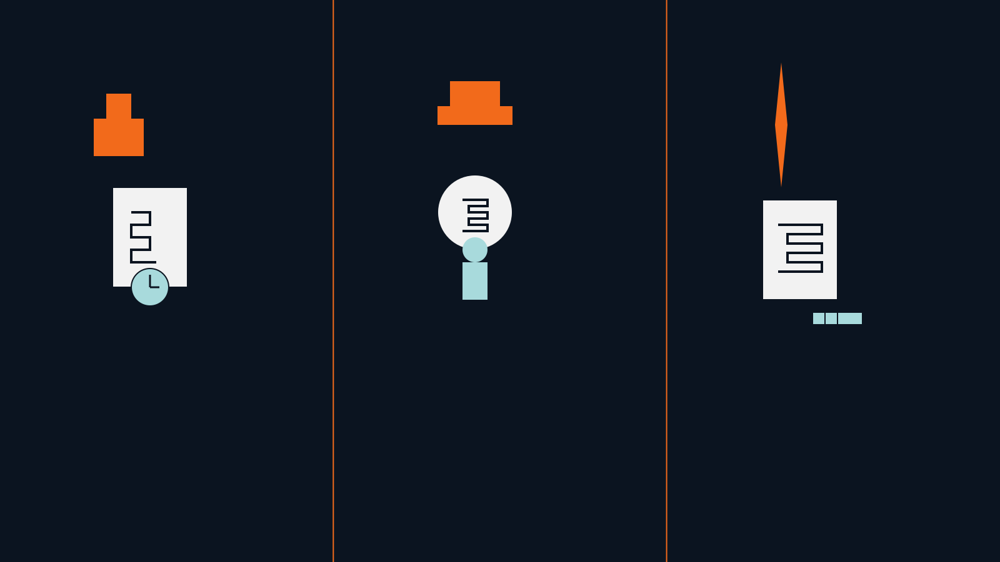

# Минимальная заработная плата в России, Германии и Франции: как устроены правила и что важно учитывать при сравнении

Минимальная заработная плата (МРОТ) — ключевой показатель уровня жизни, который регулирует нижний предел дохода работников. В разных странах правила её установления, индексация и практическое применение различаются не только из‑за экономических условий, но и из‑за правовых традиций, структуры рынка труда и социальной политики. В статье рассматриваем, как формируется МРОТ в России, Германии и Франции, какие ограничения накладывают законодательство и какие нюансы следует учитывать при международных сравнениях.

## Правовая база и механизмы индексации

### Россия
В России минимальный размер оплаты труда (МРОТ) устанавливается ежегодно указом Президента в соответствии со статьёй 136 Трудового кодекса РФ. При расчёте учитываются средняя заработная плата в стране, инфляция и динамика цен на продовольственные товары. С 2024 года МРОТ фиксируется на уровне 16 500 рублей в месяц, а с 1 января 2025 года — 17 500 рублей, что отражает индексацию на 6 % в связи с ростом потребительских цен, опубликованным Росстатом в декабре 2024 года.

### Германия
В Германии минимальная заработная плата (Mindestlohn) регулируется Законом о минимальном заработке (Mindestlohngesetz). Ставка пересматривается каждый год Федеральным советом по минимальному заработку (Mindestlohnkommission), который учитывает данные о средней заработной плате, уровне безработицы и инфляции. На 1 января 2026 года минимальная часовая ставка составила 12,00 евро, что на 3 % выше, чем в 2025 году, согласно решению комиссии, опубликованному в официальном бюллетене Федерального министерства труда.

### Франция
Во Франции минимальная заработная плата (SMIC) определяется законом и индексируется каждый январь в соответствии с инфляцией и ростом средней заработной платы в частном секторе. На 1 января 2026 года SMIC составил 1 747,20 евро в месяц (по 35‑часовой рабочей неделе), что соответствует росту на 2,2 % по сравнению с 2025 годом, как указано в постановлении Министерства труда, опубликованном в официальном журнале «Légifrance».

## Составные элементы и способы расчёта

### Россия
МРОТ в России рассчитывается как фиксированная сумма в месяц, независимо от количества отработанных часов, если работник трудится на полную ставку (40 часов в неделю). Для неполной занятости применяется пропорциональное уменьшение. Важно отметить, что в некоторых отраслях (например, в сельском хозяйстве) действуют отдельные минимальные ставки, установленные региональными нормативными актами, что ограничивает возможность прямого сравнения с другими странами.

### Германия
В Германии МИНЗАТ (Mindestlohn) фиксируется в виде часовой ставки, что делает расчёт более гибким при разных формах занятости (полный/неполный день, сменный график). При расчёте месячной заработной платы учитывается фактическое количество отработанных часов, а также надбавки за работу в ночное время, в выходные и праздничные дни, которые не могут опускаться ниже часовой минимальной ставки.

### Франция
Во Франции SMIC рассчитывается как часовая ставка (11,27 евро в 2026 году), умноженная на нормативную продолжительность рабочей недели (35 часов). При этом в расчёт включаются надбавки за сверхурочную работу (25 % за первые 8 часов сверхурочно, 50 % за последующие) и дополнительные выплаты (например, за работу в ночные часы), которые также не могут опускаться ниже установленного порога.

## Практические последствия для работников

### Россия
Для большинства работников в России МРОТ остаётся «потолком» ниже которого закон не допускает оплаты труда. Однако в реальности значительная часть работников в сфере услуг и сельского хозяйства получает заработную плату, близкую к МРОТ, что приводит к низкой покупательной способности. По данным Росстата, в 2025 году более 30 % работников в регионах с низким уровнем доходов получали не более 1,2 множества МРОТ.

### Германия
В Германии минимальная часовая ставка обеспечивает более высокий уровень дохода даже при неполной занятости. По данным Федерального агентства труда (Bundesagentur für Arbeit), в 2025 году более 70 % работников, получающих минимум, имели доход выше прожиточного минимума, определённого Институтом социального исследования (ISR). Тем не менее, в отраслях с высоким уровнем временной занятости (например, в сфере логистики) остаются случаи, когда фактическая заработная плата после вычета надбавок оказывается лишь слегка выше МИНЗАТ.

### Франция
Во Франции SMIC обеспечивает базовый доход, который покрывает минимум расходов на жильё и продовольствие в большинстве регионов, однако в Париже и крупных мегаполисах стоимость жизни выше, и даже при полной занятости работники часто прибегают к дополнительным социальным выплатам (например, RSA). По данным INSEE, в 2025 году около 15 % получателей SMIC нуждались в государственной поддержке для покрытия расходов на жильё.

## Ограничения сравнения и методологические нюансы

1. **Разные единицы измерения**: в России МРОТ указывается как фиксированная месячная сумма, тогда как в Германии и Франции — как часовая ставка. Для сопоставления необходимо переводить российскую сумму в часовой эквивалент, учитывая нормативную продолжительность рабочего времени (40 часов в неделю). При этом получаемый показатель (≈ 108 рублей/час в 2026 году) не учитывает надбавки, характерные для немецкой и французской систем.

2. **Региональные различия**: в России отдельные регионы могут устанавливать дополнительные минимумы, а в Германии существуют отраслевые «коллективные» минимумы, которые могут превышать общенациональный МИНЗАТ. Во Франции SMIC одинаков по всей стране, но реальная покупательная способность сильно варьируется между регионами.

3. **Инфляция и индексация**: в России индексация МРОТ происходит раз в год в фиксированную дату, в то время как в Германии и Франции индексация привязана к официальным инфляционным показателям и может корректироваться в течение года в случае резкого роста цен.

4. **Социальные надбавки**: в Германии и Франции к минимальной ставке добавляются обязательные надбавки (например, за работу в ночное время), что повышает реальный доход. В России такие надбавки регулируются отдельными нормативными актами и часто зависят от коллективных договоров, что усложняет прямое сравнение.

## Выводы

Минимальная заработная плата в России, Германии и Франции формируется по разным правовым схемам и отражает различия в структуре рынка труда и социальной политики. Российский МРОТ фиксирован в рублях за месяц и, несмотря на ежегодную индексацию, остаётся ниже уровня, обеспечивающего комфортную жизнь в большинстве регионов. Немецкая система, основанная на часовой ставке и ежегодных рекомендациях независимой комиссии, обеспечивает более гибкое и, в среднем, более высокий доход даже при частичной занятости. Французский SMIC, также рассчитанный как часовая ставка, сочетает в себе строгую индексацию и обязательные надбавки, но в дорогих мегаполисах его покупательная способность ограничена, что требует дополнительных социальных выплат.

При международных сравнениях необходимо учитывать различия в методиках расчёта, региональные надбавки и уровень инфляции, а также реальную покупательную способность, которая определяется не только номинальной ставкой, но и стоимостью жизни в конкретных регионах.

## Источники
- [Минтруд России — Ежегодные основные и дополнительные отпуска](https://mintrud.gov.ru/ministry/programms/trudotn/otpusk)
- [Финляндия — InfoFinland: Holidays and leaves](https://infofinland.fi/en/work-and-enterprise/during-employment/holidays-and-leaves)
- [Finlex — Annual Holidays Act](https://www.finlex.fi/api/media/statute-foreign-language-translation/688386/mainPdf/main.pdf)
- [U.S. Department of Labor — Vacation Leave](https://www.dol.gov/general/topic/workhours/vacation_leave)
- [U.S. Bureau of Labor Statistics — Paid Vacations](https://www.bls.gov/ebs/factsheets/paid-vacations.htm)
